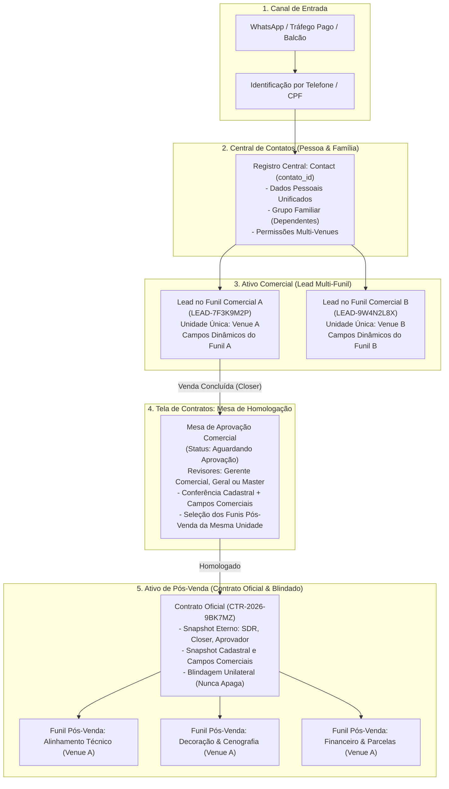
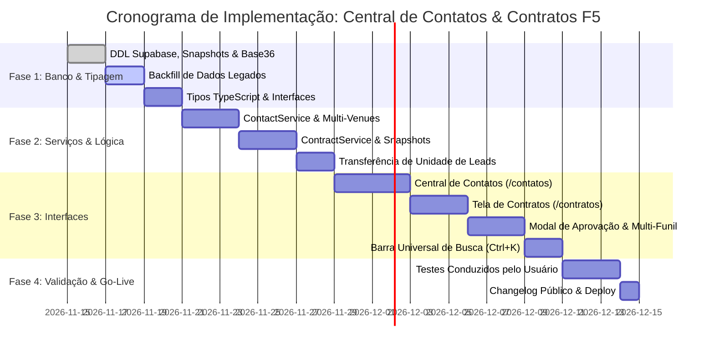

# F5 System • Plano de Ação Arquitetural: Central de Contatos, Leads Multi-Funil & Gestão Unificada de Contratos

> **Documento de Especificação Técnica & Executiva**  
> **Versão:** 1.2.0 • **Data:** Novembro de 2026  
> **Status:** Em Planejamento Aprovado (`/goal`)  
> **Alinhamento:** [F5_SYSTEM_MASTER.md](file:///c:/Users/--/OneDrive/Documents/Codex%20Projetos/Bonomo%20Festas%202/F5_SYSTEM_MASTER.md) • Regra Suprema de Isolamento Master (`master_id`) & Multi-Casas (`venues`).

---

## Sumário Executivo

Este plano de ação estabelece a reestruturação arquitetural do **F5 System** no tratamento de pessoas, oportunidades comerciais e entregas de contratos de eventos.

Historicamente, o sistema tratava cada entrada de telefone diretamente como um registro na tabela `leads`. Na conversão de venda, esse lead era **duplicado** para a tabela `clients`, gerando quebra de histórico, redundância de dados cadastrais, perda de rastreabilidade e impossibilidade de atender clientes recorrentes ou gerenciar múltiplos funis de pós-venda de forma coesa.

### Os Quatro Pilares da Nova Arquitetura
1. **Entidade Pessoa Única (`contacts`):** O número de telefone ou documento pertence a um **Contato**. O contato armazena dados cadastrais vivos (nome, telefone(s), e-mail, CPF, endereço, foto e grupo familiar/dependentes).
2. **Ativos Comerciais Independentes (`leads`):** O contato pode ser um lead em um ou múltiplos funis comerciais simultaneamente, carregando um código próprio (`LEAD-XXXXXXXX`), respostas de qualificação e campos comerciais dinâmicos. **Regra de Ouro:** cada lead pertence a **uma única unidade (`venue_id`)**.
3. **Ativos Pós-Venda por Contrato (`contracts`):** A conversão comercial homologa um **Contrato de Evento** (`CTR-AAAA-XXXXXX`). Um mesmo contato pode ter múltiplos contratos ao longo dos anos. Cada contrato pertence a **uma única unidade (`venue_id`)**, mas pode ser distribuído para múltiplos funis de pós-venda daquela casa.
4. **Princípio de Imutabilidade e Snapshot Eterno do Contrato:** O contrato é um documento jurídico fechado e blindado. No instante da aprovação, é gerado um **congelamento unilateral** dos dados: responsáveis (SDR, Closer, Gerente Aprovador), dados cadastrais do cliente e campos comerciais herdados são salvos de forma permanente. **Nada do que for alterado ou excluído futuramente na Central de Contatos ou nos Funis afetará o Contrato**.



---

## 1. Regra de Ouro: Imutabilidade, Snapshot Eterno & Blindagem do Contrato

### 1.1. Comunicação Unilateral (Lead/Contato $\longrightarrow$ Contrato)
* A comunicação entre a base viva (Contatos e Leads) e os Contratos é **estritamente unilateral**:
  - No momento da homologação, o contrato "tira uma foto" (snapshot) completa dos dados cadastrais do cliente e dos campos dinâmicos preenchidos no funil.
  - A partir desse momento, o contrato **desconecta suas informações de atualizações posteriores**.
  - Se um usuário alterar o e-mail do contato, apagar o campo "Profissão" das configurações do funil ou até mesmo arquivar o contato, **o Contrato permanece 100% inalterado**, garantindo integridade jurídica e auditoria eterna.

### 1.2. Registro Eterno dos Responsáveis da Venda
No fechamento do contrato, o sistema grava não apenas as chaves de relacionamento (`UUID`), mas também os **dados literais textuais** dos colaboradores:
* **SDR Responsável:** `sdr_id`, `sdr_name`, `sdr_email`
* **Closer Responsável:** `closer_id`, `closer_name`, `closer_email`
* **Aprovador (Gerente Comercial, Geral ou Master):** `approved_by_id`, `approved_by_name`, `approved_by_role`, `approved_at`

> 🛡️ **Comportamento Visual e de Integridade:**  
> - Se o colaborador estiver **ativo no sistema**: a interface carrega dinamicamente seu avatar, cargo atual e status.  
> - Se o colaborador for **desativado ou excluído do banco** (`ON DELETE SET NULL`): a interface recorre automaticamente aos campos literais congelados (`sdr_name`, `closer_name`, `approved_by_name`). **O nome do responsável nunca desaparece do contrato.**

---

## 2. Regras de Capacidade dos Identificadores (Escalabilidade Quase Infinita)

Para garantir que o F5 System **nunca atinja limites numéricos ou sofra estouro de sequencial**, todos os identificadores públicos utilizam codificação **alfanumérica de alta entropia** (base36 maiúscula: dígitos `0-9` e letras `A-Z`):

| Entidade | Padrão do Código | Exemplo Real | Capacidade / Combinações Possíveis |
| :--- | :--- | :--- | :--- |
| **Contrato** | `CTR-AAAA-XXXXXX` | `CTR-2026-9BK7MZ` | **$36^6 \approx 2,17$ bilhões de contratos por ano** por Master |
| **Lead** | `LEAD-XXXXXXXX` | `LEAD-7F3K9M2P` | **$36^8 \approx 2,82$ trilhões de leads** por Master |
| **Contato** | `CONT-XXXXXXXX` | `CONT-4H8W2N9Q` | **$36^8 \approx 2,82$ trilhões de contatos** por Master |

---

## 3. Especificação do Banco de Dados (PostgreSQL / Supabase)

### 3.1. Função de Geração de Códigos Alfanuméricos
```sql
CREATE OR REPLACE FUNCTION public.generate_alphanumeric_code(prefix TEXT, length INT)
RETURNS TEXT AS $$
DECLARE
    chars TEXT := '0123456789ABCDEFGHIJKLMNOPQRSTUVWXYZ';
    result TEXT := '';
    i INT;
BEGIN
    FOR i IN 1..length LOOP
        result := result || substr(chars, floor(random() * length(chars) + 1)::int, 1);
    END LOOP;
    RETURN prefix || '-' || result;
END;
$$ LANGUAGE plpgsql;
```

### 3.2. Tabela: `contacts` (Central de Contatos)
```sql
CREATE TABLE public.contacts (
    id UUID PRIMARY KEY DEFAULT gen_random_uuid(),
    master_id UUID NOT NULL REFERENCES public.masters(id) ON DELETE RESTRICT,
    code TEXT NOT NULL, -- Ex: "CONT-4H8W2N9Q"
    name TEXT NOT NULL,
    nickname TEXT,
    primary_phone TEXT NOT NULL,
    secondary_phone TEXT,
    email TEXT,
    cpf TEXT,
    rg TEXT,
    birth_date DATE,
    profile_picture_url TEXT,
    
    -- Endereço Completo
    postal_code TEXT,
    street TEXT,
    number TEXT,
    complement TEXT,
    neighborhood TEXT,
    city TEXT,
    state TEXT,

    -- Família e Metadados
    family_group_id UUID REFERENCES public.family_groups(id) ON DELETE SET NULL,
    relationship_role TEXT,
    notes TEXT,
    custom_fields JSONB DEFAULT '{}'::jsonb,
    
    -- Auditoria
    created_by UUID REFERENCES public.collaborators(id) ON DELETE SET NULL,
    updated_by UUID REFERENCES public.collaborators(id) ON DELETE SET NULL,
    created_at TIMESTAMPTZ NOT NULL DEFAULT timezone('utc'::text, now()),
    updated_at TIMESTAMPTZ NOT NULL DEFAULT timezone('utc'::text, now()),
    deleted_at TIMESTAMPTZ
);

CREATE UNIQUE INDEX idx_contacts_master_primary_phone ON public.contacts (master_id, primary_phone) WHERE deleted_at IS NULL;
CREATE UNIQUE INDEX idx_contacts_master_code ON public.contacts (master_id, code);
CREATE INDEX idx_contacts_master_cpf ON public.contacts (master_id, cpf) WHERE deleted_at IS NULL;
CREATE INDEX idx_contacts_master_name ON public.contacts (master_id, name);
```

### 3.3. Tabela: `contact_venue_access` (Isolamento Multi-Casas de Contatos)
```sql
CREATE TABLE public.contact_venue_access (
    id UUID PRIMARY KEY DEFAULT gen_random_uuid(),
    master_id UUID NOT NULL REFERENCES public.masters(id) ON DELETE CASCADE,
    contact_id UUID NOT NULL REFERENCES public.contacts(id) ON DELETE CASCADE,
    venue_id UUID NOT NULL REFERENCES public.venues(id) ON DELETE CASCADE,
    first_interaction_at TIMESTAMPTZ NOT NULL DEFAULT timezone('utc'::text, now()),
    last_interaction_at TIMESTAMPTZ NOT NULL DEFAULT timezone('utc'::text, now()),
    origin_source_id UUID REFERENCES public.lead_sources(id) ON DELETE SET NULL,
    created_at TIMESTAMPTZ NOT NULL DEFAULT timezone('utc'::text, now()),
    CONSTRAINT uq_contact_venue UNIQUE (contact_id, venue_id)
);

CREATE INDEX idx_contact_venue_venue_id ON public.contact_venue_access (venue_id, contact_id);
```

### 3.4. Tabelas: `family_groups` & `contact_dependents` (Grupo Familiar)
```sql
CREATE TABLE public.family_groups (
    id UUID PRIMARY KEY DEFAULT gen_random_uuid(),
    master_id UUID NOT NULL REFERENCES public.masters(id) ON DELETE CASCADE,
    name TEXT NOT NULL,
    primary_contact_id UUID REFERENCES public.contacts(id) ON DELETE SET NULL,
    notes TEXT,
    created_at TIMESTAMPTZ NOT NULL DEFAULT timezone('utc'::text, now())
);

CREATE TABLE public.contact_dependents (
    id UUID PRIMARY KEY DEFAULT gen_random_uuid(),
    master_id UUID NOT NULL REFERENCES public.masters(id) ON DELETE CASCADE,
    parent_contact_id UUID NOT NULL REFERENCES public.contacts(id) ON DELETE CASCADE,
    dependent_contact_id UUID NOT NULL REFERENCES public.contacts(id) ON DELETE CASCADE,
    kinship TEXT NOT NULL,
    created_at TIMESTAMPTZ NOT NULL DEFAULT timezone('utc'::text, now()),
    CONSTRAINT uq_contact_dependent UNIQUE (parent_contact_id, dependent_contact_id)
);
```

### 3.5. Atualização da Tabela: `leads` (Ativos Comerciais com Unidade Única)
```sql
ALTER TABLE public.leads
    ADD COLUMN IF NOT EXISTS contact_id UUID REFERENCES public.contacts(id) ON DELETE RESTRICT,
    ADD COLUMN IF NOT EXISTS commercial_code TEXT, -- Ex: "LEAD-7F3K9M2P"
    ADD COLUMN IF NOT EXISTS custom_fields_data JSONB DEFAULT '{}'::jsonb;

CREATE UNIQUE INDEX IF NOT EXISTS idx_leads_master_commercial_code ON public.leads (master_id, commercial_code);
CREATE INDEX IF NOT EXISTS idx_leads_contact_id ON public.leads (contact_id);
CREATE INDEX IF NOT EXISTS idx_leads_venue_id ON public.leads (venue_id);
```

### 3.6. Tabela: `contracts` (Ativos Contratuais Blindados com Snapshot Eterno)
```sql
CREATE TABLE public.contracts (
    id UUID PRIMARY KEY DEFAULT gen_random_uuid(),
    master_id UUID NOT NULL REFERENCES public.masters(id) ON DELETE RESTRICT,
    contract_code TEXT NOT NULL, -- Ex: "CTR-2026-9BK7MZ"
    contact_id UUID NOT NULL REFERENCES public.contacts(id) ON DELETE RESTRICT,
    origin_lead_id UUID REFERENCES public.leads(id) ON DELETE SET NULL,
    origin_funnel_id UUID REFERENCES public.commercial_funnels(id) ON DELETE SET NULL,
    venue_id UUID NOT NULL REFERENCES public.venues(id) ON DELETE RESTRICT, -- REGRA: UNIDADE ÚNICA
    
    -- Dados do Evento
    event_type TEXT NOT NULL,
    event_title TEXT NOT NULL,
    event_date DATE,
    guest_count INTEGER,
    package_name TEXT,
    
    -- SNAPSHOT IMUTÁVEL: Dados Pessoais do Cliente no Fechamento (Blindagem Unilateral)
    client_snapshot JSONB NOT NULL DEFAULT '{}'::jsonb,
    
    -- SNAPSHOT IMUTÁVEL: Campos Comerciais do Funil Herdados (Nunca são apagados)
    commercial_fields_snapshot JSONB NOT NULL DEFAULT '{}'::jsonb,
    
    -- Valores Financeiros do Contrato
    total_amount NUMERIC(12, 2) NOT NULL DEFAULT 0.00,
    payment_terms JSONB DEFAULT '{}'::jsonb,
    
    -- RESPONSÁVEIS ETERNOS DA VENDA (Preservados mesmo se o usuário for deletado)
    sdr_id UUID REFERENCES public.collaborators(id) ON DELETE SET NULL,
    sdr_name TEXT NOT NULL, -- Snapshot eterno do nome
    sdr_email TEXT,

    closer_id UUID REFERENCES public.collaborators(id) ON DELETE SET NULL,
    closer_name TEXT NOT NULL, -- Snapshot eterno do nome
    closer_email TEXT,

    -- Mesa de Aprovação & Governança (Exclusiva para Gerente Comercial, Geral ou Master)
    approval_status TEXT NOT NULL DEFAULT 'pending_approval', 
    submitted_by UUID REFERENCES public.collaborators(id) ON DELETE SET NULL,
    submitted_at TIMESTAMPTZ NOT NULL DEFAULT timezone('utc'::text, now()),
    approved_by UUID REFERENCES public.collaborators(id) ON DELETE SET NULL,
    approved_by_name TEXT, -- Snapshot eterno do nome do aprovador
    approved_by_role TEXT, -- Ex: "gerente_comercial", "gerente_geral", "master"
    approved_at TIMESTAMPTZ,
    rejection_reason TEXT,
    
    -- Seleção dos Funis Pós-Venda Destino (Restritos à mesma venue_id)
    target_pos_sale_funnel_ids UUID[] DEFAULT '{}'::uuid[],
    
    -- Passagem de Bastão & Documentação
    handover_notes TEXT,
    contract_file_url TEXT,
    attachments JSONB DEFAULT '[]'::jsonb,
    
    created_at TIMESTAMPTZ NOT NULL DEFAULT timezone('utc'::text, now()),
    updated_at TIMESTAMPTZ NOT NULL DEFAULT timezone('utc'::text, now())
);

CREATE UNIQUE INDEX idx_contracts_master_code ON public.contracts (master_id, contract_code);
CREATE INDEX idx_contracts_contact_id ON public.contracts (contact_id);
CREATE INDEX idx_contracts_venue_id ON public.contracts (venue_id);
CREATE INDEX idx_contracts_approval_status ON public.contracts (master_id, approval_status);
```

### 3.7. Tabela: `contract_funnel_placements` (Multi-Funil Pós-Venda na Mesma Unidade)
```sql
CREATE TABLE public.contract_funnel_placements (
    id UUID PRIMARY KEY DEFAULT gen_random_uuid(),
    master_id UUID NOT NULL REFERENCES public.masters(id) ON DELETE CASCADE,
    contract_id UUID NOT NULL REFERENCES public.contracts(id) ON DELETE CASCADE,
    funnel_id UUID NOT NULL REFERENCES public.commercial_funnels(id) ON DELETE RESTRICT,
    stage_id UUID NOT NULL REFERENCES public.funnel_stages(id) ON DELETE RESTRICT,
    assigned_to UUID REFERENCES public.collaborators(id) ON DELETE SET NULL,
    status TEXT NOT NULL DEFAULT 'in_progress',
    completed_at TIMESTAMPTZ,
    notes TEXT,
    order_index INTEGER DEFAULT 0,
    created_at TIMESTAMPTZ NOT NULL DEFAULT timezone('utc'::text, now()),
    updated_at TIMESTAMPTZ NOT NULL DEFAULT timezone('utc'::text, now()),
    CONSTRAINT uq_contract_funnel UNIQUE (contract_id, funnel_id)
);

CREATE INDEX idx_contract_placements_funnel_stage ON public.contract_funnel_placements (funnel_id, stage_id);
CREATE INDEX idx_contract_placements_assigned ON public.contract_funnel_placements (assigned_to);
```

---

## 4. Matriz de Cargos, Governança & Regras de Acesso (RBAC)

| Cargo (`role`) | Central de Contatos | Leads / CRM Comercial | Mesa de Aprovação de Contratos | Funis Pós-Venda | Exclusão de Contatos |
| :--- | :---: | :---: | :---: | :---: | :---: |
| **`master`** | Total (Todas as unidades da rede) | Total (Todos os funis e unidades) | **Aprovação e Homologação Global** | Total (Todos os funis) | Permitida (Se não houver ativos) |
| **`gerente_geral`** | Total nas unidades atribuídas | Total nas unidades atribuídas | **Aprovação e Homologação nas Casas** | Total nas unidades atribuídas | Permitida (Se não houver ativos) |
| **`gerente_comercial`** | Consulta e edição nas unidades | Total nos funis comerciais | **Aprovação e Homologação Comercial** | Apenas leitura | Bloqueada |
| **`gerente_pos_venda`** | Consulta e edição nas unidades | Apenas leitura de fechamento | Visualização (Leitura de Contratos) | **Gestão Total do Pós-Venda** | Bloqueada |
| **`comercial` (SDR/Closer)** | Visualização de seus contatos | Edição de leads atribuídos | Submissão de propostas (Sem aprovação) | Sem acesso | Bloqueada |
| **`pos_venda`** | Visualização de clientes/contratos | Sem acesso | Sem acesso | Edição nos funis atribuídos | Bloqueada |

---

## 5. Fluxos Operacionais & Regras de Negócio

### 5.1. Regra de Unidade Única e Transferência de Leads entre Unidades
1. **Unidade Única:** Todo lead pertence estritamente a uma única unidade (`venue_id`).
2. **Transferência de Unidade:**
   - O operador ou gerente aciona **"Transferir Unidade do Lead"**:
     1. Escolhe a **Unidade de Destino**.
     2. Se o usuário **tem permissão** nos funis de destino: seleciona diretamente o funil e etapa.
     3. Se o usuário **não tem permissão** nos funis de destino: o sistema transfere o lead para o **primeiro funil de entrada padrão** daquela unidade com notificação para a gerência local.

### 5.2. Tela de Contratos & Mesa de Aprovação Gerencial (`/admin/contratos`)
A tela de Contratos opera com **duas abas principais**:
- **Aba 1: Contratos para Aprovação (Pendentes)**
- **Aba 2: Contratos Aprovados (Vigentes)**

#### Modal de Homologação de Contrato (Aprovação por Gerente Comercial, Geral ou Master):
1. **Dados Cadastrais do Cliente (Snapshot Inicial):** Nome completo, Telefones, CPF, RG, Endereço completo.
2. **Campos Comerciais Herdados:** Exibição dinâmica de todas as perguntas e respostas preenchidas durante a venda no funil comercial.
3. **Responsáveis:** Identificação de SDR e Closer responsáveis.
4. **Distribuição Pós-Venda Restrita à Mesma Unidade:** Lista com checkboxes dos funis de pós-venda disponíveis **apenas para aquela unidade (`venue_id`)**.
5. **Ação de Homologação:** Ao clicar em `Homologar Contrato`:
   - Grava `approved_by_name`, `approved_by_role` e timestamp permanente.
   - Congela `client_snapshot` e `commercial_fields_snapshot`.
   - Gera os registros em `contract_funnel_placements` para os funis de pós-venda selecionados.

---

## 6. Especificação de Telas (UI/UX)

### 6.1. Central de Contatos (`/admin/contatos`)
- **Layout Bilateral (Split View):**
  - Esquerda: Lista de contatos pesquisável com chips de status e unidades.
  - Direita: Ficha de contato, dados cadastrais, grupo familiar e abas de Oportunidades Comerciais, Contratos Assinados e Timeline de Atividades.

### 6.2. Barra de Pesquisa Universal Overlay (`Ctrl + K`)
- Atalho global no topo da Área de Conteúdo.
- Busca unificada e categorizada por Contatos (`CONT-XXXXXXXX`), Contratos (`CTR-AAAA-XXXXXX`), Leads (`LEAD-XXXXXXXX`) e Familiares.

---

## 7. Cronograma Fatiado em Fases (Sprints de Entrega)



---

## 8. Critérios de Aceite e Validação de Sucesso

1. **Snapshot Eterno dos Responsáveis:** SDR, Closer e Gerente Aprovador possuem nomes congelados no contrato, garantindo exibição vitalícia mesmo após exclusão de colaboradores.
2. **Blindagem Unilateral:** Exclusões ou alterações cadastrais ou de campos no CRM não alteram os dados de contratos já fechados.
3. **Escalabilidade Alfanumérica:** Códigos Base36 garantem que limites numéricos nunca sejam atingidos.
4. **Unidade Única:** Lead e Contrato pertencem a um único `venue_id`.
5. **Pós-Venda Restrito:** Funis de pós-venda selecionáveis na aprovação pertencem estritamente à mesma casa do contrato.
6. **Alçada Gerencial:** Apenas `gerente_comercial`, `gerente_geral` e `master` homologam contratos.
7. **Isolamento Absoluto:** Zero vazamento entre tenants (`master_id`).

---
*Documento homologado para execução no F5 System.*
