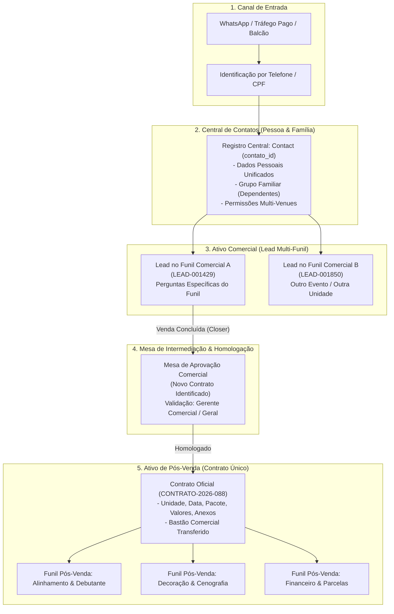
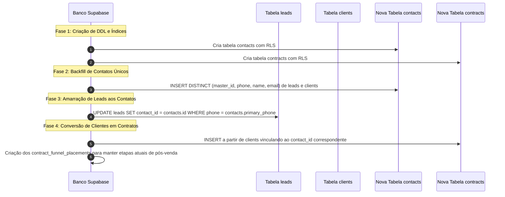

# F5 System • Plano de Ação Arquitetural: Central de Contatos, Leads Multi-Funil & Gestão Unificada de Contratos

> **Documento de Especificação Técnica & Executiva**  
> **Versão:** 1.0.0 • **Data:** Novembro de 2026  
> **Status:** Em Planejamento Aprovado (`/goal`)  
> **Alinhamento:** [F5_SYSTEM_MASTER.md](file:///c:/Users/--/OneDrive/Documents/Codex%20Projetos/Bonomo%20Festas%202/F5_SYSTEM_MASTER.md) • Regra Suprema de Isolamento Master (`master_id`) & Multi-Casas (`venues`).

---

## Sumário Executivo

Este plano de ação estabelece a reestruturação arquitetural do **F5 System** no tratamento de pessoas, oportunidades comerciais e entregas de eventos.

Historicamente, o sistema tratava cada entrada de telefone diretamente como um registro na tabela `leads`. Na conversão de venda, esse lead era **duplicado** para a tabela `clients`, gerando quebra de histórico, redundância de dados cadastrais, perda de rastreabilidade e impossibilidade de atender clientes recorrentes ou gerenciar múltiplos funis de pós-venda de forma coesa.

### Os Três Pilares da Nova Arquitetura
1. **Entidade Pessoa Única (`contacts`):** O número de telefone ou documento pertence a um **Contato**. O contato armazena todos os dados cadastrais (nome, telefone(s), e-mail, CPF, endereço, foto e grupo familiar/dependentes). Qualquer atualização cadastral reflete em tempo real em todas as frentes.
2. **Ativos Comerciais Independentes (`leads`):** O contato pode ser um lead em um ou múltiplos funis comerciais simultaneamente, carregando um código próprio (`LEAD-XXXXXX`), respostas do formulário daquele funil e histórico comercial específico.
3. **Ativos Pós-Venda por Contrato (`contracts`):** A conversão comercial não cria um "cliente duplicado", mas sim homologa um **Contrato de Evento** (`CONTRATO-XXXX`). Um mesmo contato pode ter múltiplos contratos ao longo dos anos. O mesmo contrato é distribuído de forma sincronizada para múltiplos funis de pós-venda (Financeiro, Decoração, Alinhamento Técnico, Cerimonial) com estágios independentes.



---

## 1. Diagnóstico do Modelo Atual vs. Novo Modelo F5 System

| Aspecto | Modelo Anterior (Legado) | Novo Modelo Arquitetural (F5 System) |
| :--- | :--- | :--- |
| **Ponto Central** | Tabela `leads` era a raiz de tudo. | Tabela `contacts` é a raiz de identidade da pessoa. |
| **Conversão de Venda** | Duplicação de registro de `leads` para `clients` com novo ID arbitrário. | Conversão gera um **Contrato** (`contracts`) vinculado ao contato. Zero duplicação. |
| **Multi-Funil Comercial** | Difícil controle de leads duplicados; sobreposição de conversas de WhatsApp. | O mesmo contato possui instâncias de `leads` distintas por funil, com roteamento inteligente de WhatsApp pela origem da conversa. |
| **Pós-Venda** | Um único funil de pós-venda amarrado ao `clients.stage_id`. | Distribuição do mesmo contrato para **múltiplos funis de pós-venda** (`contract_funnel_placements`), cada qual com seu responsável e etapa. |
| **Grupo Familiar** | Nenhum suporte; mãe e debutante eram leads separados sem conexão. | Suporte nativo a grupos familiares e dependentes (`family_groups` e `contact_dependents`). Mensagens de familiares são reconhecidas no contexto do contrato. |
| **Governança & Aprovação** | O próprio Closer convertia e mandava direto pro pós-venda sem conferência. | **Mesa de Intermediação e Aprovação Comercial**: contratos ficam em fila de homologação por gerentes antes de entrar em execução. |
| **Isolamento de Unidades** | Apenas por `venue_id` do lead. | `contact_venue_access` rastreia em quais casas o contato interagiu. Não-Master só vê contatos de suas unidades atribuídas. |

---

## 2. Especificação do Banco de Dados (PostgreSQL / Supabase)

### 2.1. Tabela: `contacts` (Central de Contatos)
Raiz única para dados pessoais do indivíduo no tenant Master.

```sql
CREATE TABLE public.contacts (
    id UUID PRIMARY KEY DEFAULT gen_random_uuid(),
    master_id UUID NOT NULL REFERENCES public.masters(id) ON DELETE RESTRICT,
    code TEXT NOT NULL, -- Ex: "CONT-008124"
    name TEXT NOT NULL,
    nickname TEXT,
    primary_phone TEXT NOT NULL,
    secondary_phone TEXT,
    email TEXT,
    cpf TEXT,
    rg TEXT,
    birth_date DATE,
    profile_picture_url TEXT,
    
    -- Endereço
    postal_code TEXT,
    street TEXT,
    number TEXT,
    complement TEXT,
    neighborhood TEXT,
    city TEXT,
    state TEXT,

    -- Família e Metadados
    family_group_id UUID REFERENCES public.family_groups(id) ON DELETE SET NULL,
    relationship_role TEXT, -- Ex: "Pai", "Mãe", "Debutante", "Noivo", "Contratante", "Titular"
    notes TEXT,
    custom_fields JSONB DEFAULT '{}'::jsonb,
    
    -- Auditoria
    created_by UUID REFERENCES public.collaborators(id) ON DELETE SET NULL,
    updated_by UUID REFERENCES public.collaborators(id) ON DELETE SET NULL,
    created_at TIMESTAMPTZ NOT NULL DEFAULT timezone('utc'::text, now()),
    updated_at TIMESTAMPTZ NOT NULL DEFAULT timezone('utc'::text, now()),
    deleted_at TIMESTAMPTZ
);

-- Índices de Performance e Unicidade
CREATE UNIQUE INDEX idx_contacts_master_primary_phone ON public.contacts (master_id, primary_phone) WHERE deleted_at IS NULL;
CREATE INDEX idx_contacts_master_cpf ON public.contacts (master_id, cpf) WHERE deleted_at IS NULL;
CREATE INDEX idx_contacts_master_name ON public.contacts (master_id, name);
CREATE INDEX idx_contacts_code ON public.contacts (master_id, code);
```

### 2.2. Tabela: `contact_venue_access` (Isolamento Multi-Casas)
Mapeia a quais casas de festa (`venues`) o contato pertence por histórico de atendimento.

```sql
CREATE TABLE public.contact_venue_access (
    id UUID PRIMARY KEY DEFAULT gen_random_uuid(),
    master_id UUID NOT NULL REFERENCES public.masters(id) ON DELETE CASCADE,
    contact_id UUID NOT NULL REFERENCES public.contacts(id) ON DELETE CASCADE,
    venue_id UUID NOT NULL REFERENCES public.venues(id) ON DELETE CASCADE,
    first_interaction_at TIMESTAMPTZ NOT NULL DEFAULT timezone('utc'::text, now()),
    last_interaction_at TIMESTAMPTZ NOT NULL DEFAULT timezone('utc'::text, now()),
    origin_source_id UUID REFERENCES public.lead_sources(id) ON DELETE SET NULL,
    created_at TIMESTAMPTZ NOT NULL DEFAULT timezone('utc'::text, now()),
    CONSTRAINT uq_contact_venue UNIQUE (contact_id, venue_id)
);

CREATE INDEX idx_contact_venue_venue_id ON public.contact_venue_access (venue_id, contact_id);
```

### 2.3. Tabelas: `family_groups` & `contact_dependents` (Grupo Familiar)
Permite conectar mãe, debutante, pai e patrocinador sob o mesmo grupo familiar.

```sql
CREATE TABLE public.family_groups (
    id UUID PRIMARY KEY DEFAULT gen_random_uuid(),
    master_id UUID NOT NULL REFERENCES public.masters(id) ON DELETE CASCADE,
    name TEXT NOT NULL, -- Ex: "Família Albuquerque Silva"
    primary_contact_id UUID REFERENCES public.contacts(id) ON DELETE SET NULL,
    notes TEXT,
    created_at TIMESTAMPTZ NOT NULL DEFAULT timezone('utc'::text, now())
);

CREATE TABLE public.contact_dependents (
    id UUID PRIMARY KEY DEFAULT gen_random_uuid(),
    master_id UUID NOT NULL REFERENCES public.masters(id) ON DELETE CASCADE,
    parent_contact_id UUID NOT NULL REFERENCES public.contacts(id) ON DELETE CASCADE,
    dependent_contact_id UUID NOT NULL REFERENCES public.contacts(id) ON DELETE CASCADE,
    kinship TEXT NOT NULL, -- "Filho(a) / Debutante", "Cônjuge", "Mãe", "Pai", "Responsável Financeiro"
    created_at TIMESTAMPTZ NOT NULL DEFAULT timezone('utc'::text, now()),
    CONSTRAINT uq_contact_dependent UNIQUE (parent_contact_id, dependent_contact_id)
);
```

### 2.4. Atualização da Tabela: `leads` (Ativos Comerciais)
A tabela `leads` ganha referência direta e obrigatória ao `contact_id`.

```sql
-- Alteração incremental na tabela leads existente
ALTER TABLE public.leads
    ADD COLUMN IF NOT EXISTS contact_id UUID REFERENCES public.contacts(id) ON DELETE RESTRICT,
    ADD COLUMN IF NOT EXISTS commercial_code TEXT, -- Ex: "LEAD-002819"
    ADD COLUMN IF NOT EXISTS qualification_answers JSONB DEFAULT '{}'::jsonb,
    ADD COLUMN IF NOT EXISTS contract_draft_data JSONB DEFAULT '{}'::jsonb;

CREATE INDEX IF NOT EXISTS idx_leads_contact_id ON public.leads (contact_id);
CREATE INDEX IF NOT EXISTS idx_leads_master_commercial_code ON public.leads (master_id, commercial_code);
```

### 2.5. Tabela: `contracts` (Ativos Contratuais de Evento)
Substitui a lógica de duplicação para `clients`, formalizando o contrato de prestação de serviços para a festa.

```sql
CREATE TABLE public.contracts (
    id UUID PRIMARY KEY DEFAULT gen_random_uuid(),
    master_id UUID NOT NULL REFERENCES public.masters(id) ON DELETE RESTRICT,
    contract_code TEXT NOT NULL, -- Ex: "CTR-2026-0041"
    contact_id UUID NOT NULL REFERENCES public.contacts(id) ON DELETE RESTRICT,
    origin_lead_id UUID REFERENCES public.leads(id) ON DELETE SET NULL,
    venue_id UUID NOT NULL REFERENCES public.venues(id) ON DELETE RESTRICT,
    
    -- Dados do Evento
    event_type TEXT NOT NULL, -- "15_anos", "casamento", "infantil", "corporativo"
    event_title TEXT NOT NULL, -- Ex: "15 Anos Manuella Albuquerque"
    event_date DATE,
    guest_count INTEGER,
    package_name TEXT,
    
    -- Valores Financeiros do Contrato
    total_amount NUMERIC(12, 2) NOT NULL DEFAULT 0.00,
    payment_terms JSONB DEFAULT '{}'::jsonb,
    
    -- Mesa de Aprovação & Governança
    approval_status TEXT NOT NULL DEFAULT 'pending_approval', 
    -- 'pending_approval' | 'approved' | 'rejected' | 'canceled' | 'completed'
    submitted_by UUID REFERENCES public.collaborators(id) ON DELETE SET NULL,
    submitted_at TIMESTAMPTZ NOT NULL DEFAULT timezone('utc'::text, now()),
    approved_by UUID REFERENCES public.collaborators(id) ON DELETE SET NULL,
    approved_at TIMESTAMPTZ,
    rejection_reason TEXT,
    
    -- Passagem de Bastão & Documentação
    handover_notes TEXT,
    contract_file_url TEXT,
    attachments JSONB DEFAULT '[]'::jsonb,
    
    created_at TIMESTAMPTZ NOT NULL DEFAULT timezone('utc'::text, now()),
    updated_at TIMESTAMPTZ NOT NULL DEFAULT timezone('utc'::text, now())
);

CREATE UNIQUE INDEX idx_contracts_master_code ON public.contracts (master_id, contract_code);
CREATE INDEX idx_contracts_contact_id ON public.contracts (contact_id);
CREATE INDEX idx_contracts_venue_id ON public.contracts (venue_id);
CREATE INDEX idx_contracts_approval_status ON public.contracts (master_id, approval_status);
```

### 2.6. Tabela: `contract_funnel_placements` (Multi-Funil Pós-Venda)
Permite que o mesmo contrato esteja em vários funis pós-venda simultaneamente (Financeiro, Decoração, Alinhamento Técnico, Cerimonial).

```sql
CREATE TABLE public.contract_funnel_placements (
    id UUID PRIMARY KEY DEFAULT gen_random_uuid(),
    master_id UUID NOT NULL REFERENCES public.masters(id) ON DELETE CASCADE,
    contract_id UUID NOT NULL REFERENCES public.contracts(id) ON DELETE CASCADE,
    funnel_id UUID NOT NULL REFERENCES public.commercial_funnels(id) ON DELETE RESTRICT,
    stage_id UUID NOT NULL REFERENCES public.funnel_stages(id) ON DELETE RESTRICT,
    assigned_to UUID REFERENCES public.collaborators(id) ON DELETE SET NULL,
    status TEXT NOT NULL DEFAULT 'in_progress', -- 'in_progress' | 'completed' | 'on_hold'
    completed_at TIMESTAMPTZ,
    notes TEXT,
    order_index INTEGER DEFAULT 0,
    created_at TIMESTAMPTZ NOT NULL DEFAULT timezone('utc'::text, now()),
    updated_at TIMESTAMPTZ NOT NULL DEFAULT timezone('utc'::text, now()),
    CONSTRAINT uq_contract_funnel UNIQUE (contract_id, funnel_id)
);

CREATE INDEX idx_contract_placements_funnel_stage ON public.contract_funnel_placements (funnel_id, stage_id);
CREATE INDEX idx_contract_placements_assigned ON public.contract_funnel_placements (assigned_to);
```

### 2.7. Sincronização Automática Bidirecional (Triggers)
Quando o nome, telefone, e-mail ou documento for alterado em um card de Lead ou na ficha de Contrato, a trigger do PostgreSQL propaga a alteração diretamente para o registro `contacts`.

```sql
-- Função PL/pgSQL para sincronizar alterações de lead para contato
CREATE OR REPLACE FUNCTION public.sync_lead_contact_info()
RETURNS TRIGGER AS $$
BEGIN
    IF NEW.contact_id IS NOT NULL THEN
        UPDATE public.contacts
        SET 
            name = COALESCE(NULLIF(NEW.name, ''), name),
            primary_phone = COALESCE(NULLIF(NEW.phone, ''), primary_phone),
            email = COALESCE(NULLIF(NEW.email, ''), email),
            updated_at = timezone('utc'::text, now())
        WHERE id = NEW.contact_id
          AND master_id = NEW.master_id;
    END IF;
    RETURN NEW;
END;
$$ LANGUAGE plpgsql;

DROP TRIGGER IF EXISTS trg_sync_lead_to_contact ON public.leads;
CREATE TRIGGER trg_sync_lead_to_contact
AFTER UPDATE OF name, phone, email ON public.leads
FOR EACH ROW
EXECUTE FUNCTION public.sync_lead_contact_info();
```

---

## 3. Matriz de Cargos, Governança & Regras de Acesso (RBAC)

Para atender à operação comercial, supervisão de contratos e pós-venda, a matriz de perfis é estruturada da seguinte forma:

| Cargo (`role`) | Central de Contatos | Leads / CRM Comercial | Mesa de Aprovação de Contratos | Funis Pós-Venda | Exclusão de Contatos |
| :--- | :---: | :---: | :---: | :---: | :---: |
| **`master`** | Total (Todas as unidades da rede) | Total (Todos os funis e unidades) | Aprovação e Reprovação Global | Total (Todos os funis) | Permitida (Se não houver ativos) |
| **`gerente_geral`** | Total nas unidades atribuídas | Total nas unidades atribuídas | **Aprovação e Reprovação** | Total nas unidades atribuídas | Permitida (Se não houver ativos) |
| **`gerente_comercial`** | Consulta e edição nas unidades | Total nos funis comerciais | **Aprovação e Homologação** | Apenas leitura | Bloqueada |
| **`gerente_pos_venda`** | Consulta e edição nas unidades | Apenas leitura de fechamento | Visualização de contratos | **Gestão Total do Pós-Venda** | Bloqueada |
| **`comercial` (SDR/Closer)** | Visualização de seus contatos | Edição de leads atribuídos | Envio de proposta para aprovação | Sem acesso | Bloqueada |
| **`pos_venda`** | Visualização de clientes/contratos | Sem acesso | Sem acesso | Edição nos funis atribuídos | Bloqueada |

### Regra Rígida de Proteção contra Exclusão de Contatos
* Contatos que possuam **ativos vigentes** (Leads abertos em funis ou Contratos ativos/pendentes) **NÃO podem ser excluídos sob hipótese alguma**.
* Tentativas de exclusão disparam aviso impeditivo: *"Não é possível excluir o contato [Nome]: existem ativos vinculados (1 lead no funil comercial e 1 contrato no pós-venda). Encerre ou arquive os ativos antes de prosseguir."*
* Apenas usuários com perfil `master` ou `gerente_geral` podem executar exclusão lógica (`deleted_at = now()`).

---

## 4. Fluxos Operacionais & Regras de Negócio

### 4.1. Entrada de Mensagens WhatsApp e Criação Automática
1. O webhook/SSE recebe uma mensagem via WhatsApp de um número não registrado.
2. O sistema executa busca por `master_id` e `primary_phone`.
3. Se não encontrar, cria instantaneamente o registro em `contacts` e gera seu código sequencial (`CONT-XXXXXX`).
4. Vincula o contato à unidade dona daquele canal via `contact_venue_access`.
5. Se a origem do WhatsApp estiver atrelada a um funil comercial, cria o card em `leads` apontando para o `contact_id`.
6. Se o número **já existia** no banco (ex: cliente antigo ou contato de outra unidade):
   - Os dados pessoais já vêm 100% preenchidos.
   - O sistema adiciona o vínculo da nova unidade em `contact_venue_access`.
   - Adiciona um novo Lead no funil comercial receptor sem sobrescrever ou destruir o histórico anterior.

### 4.2. Roteamento de Respostas de WhatsApp por Origem
* Quando o operador abre um lead para responder no WhatsApp:
  1. A prioridade padrão de canal é o **número do WhatsApp da Origem daquele Funil**.
  2. Caso o contato já tenha recebido mensagens enviadas pela equipe por outro canal específico, o sistema destaca qual foi o último canal utilizado para evitar que o cliente receba mensagens desconexas de números diferentes.

### 4.3. Fechamento Comercial e Mesa de Aprovação (Homologação)
1. **Conclusão Comercial (Closer):** O Closer preenche o formulário de fechamento na etapa de fechamento do funil comercial (dados do evento, anexo do contrato assinado, valor fechado e anotações de passagem de bastão).
2. **Entrada na Mesa de Aprovação:** O contrato é gerado em `contracts` com `approval_status = 'pending_approval'`.
3. **Revisão Gerencial:** O `gerente_comercial` ou `gerente_geral` acessa a aba **Mesa de Aprovação** (`/admin/contratos?tab=pendentes`).
4. **Homologação:** Ao clicar em **"Homologar Contrato"**:
   - O contrato passa para `approval_status = 'approved'`.
   - As metas comerciais e comissões do Closer/SDR são consolidadas no relatório gerencial.
   - O contrato é automaticamente propagado para os funis de pós-venda vinculados àquele funil comercial (`post_sale_funnel_ids`).
   - É disparada a **Passagem de Bastão**: gerada anotação de sistema no histórico do contato e registrada a mensagem de boas-vindas com selo visual de sistema na timeline do cliente.

---

## 5. Especificação de Interface do Usuário (UI/UX)

### 5.1. Central de Contatos (`/admin/contatos`)
Layout bilateral (split view responsivo) concebido para alta produtividade:

```
+----------------------------------------------------------------------------------------------------+
| [Central de Contatos]     [Filtro: Todas as Casas v] [Buscar Nome, Tel, CPF...]    [+ Novo Contato] |
+----------------------------------------------------------------------------------------------------+
| Lista de Contatos        | Painel Detalhado do Contato (CONT-002914)                              |
|                          |-------------------------------------------------------------------------|
| [Foto] Marcela Ferreira  | PERFIL PESSOAL           | ATIVOS E HISTÓRICO                           |
| (21) 99887-1122          |                          | [Oportunidades (2)] [Contratos (1)] [Linha]  |
| 1 Contrato Ativo         | Nome: Marcela Ferreira   |----------------------------------------------|
| Unidades: Rio Lounge     | CPF: 123.456.789-00      | CONTRATOS DO CLIENTE:                        |
|                          | Tel Principal: (21)...   | > CTR-2026-0041 • 15 Anos Manuella           |
|--------------------------| Email: marcela@email.com |   Data: 15/10/2026 • R$ 38.500,00            |
| [Foto] Roberto Carlos    |                          |   Unidade: Espaço Rio Lounge                 |
| (21) 98765-4321          | GRUPO FAMILIAR:          |   Funis de Pós-Venda:                        |
| 1 Lead em Qualificação   | > Manuella (Filha)       |   - Cerimonial: [Etapa: Degustação Realizada]|
| Unidades: Bonomo Festas  | > Carlos (Pai/Financeiro)|   - Decoração:  [Etapa: Cenografia Aprovada] |
|                          |                          |   - Financeiro: [Etapa: Em Dia (6/12 pagas)] |
+----------------------------------------------------------------------------------------------------+
```

### 5.2. Mesa de Homologação & Central de Contratos (`/admin/contratos`)
* **Aba 1: "Mesa de Homologação (Pendentes)"**:
  - Cards com alerta visual de contratos recém-fechados aguardando conferência de documentação e valores.
  - Botão de ação rápida: `Homologar e Liberar para Pós-Venda` ou `Solicitar Ajuste ao Comercial`.
* **Aba 2: "Contratos Vigentes (Pós-Venda)"**:
  - Tabela consolidada com busca por data de evento, código do contrato, unidade física e progresso nos funis pós-venda.

### 5.3. Barra de Pesquisa Universal Overlay (`Ctrl + K`)
* Barra de busca rápida centralizada no topo da **Área de Conteúdo**.
* Pesquisa dinâmica em tempo real com categorização visual por ícones Lucide:
  - 👤 **Contatos:** Retorna nome, telefone, CPF e quantidade de contratos.
  - 📋 **Contratos:** Busca por código (`CTR-XXXX`), homenageado da festa ou data.
  - 🎯 **Leads:** Busca por código (`LEAD-XXXX`) e funil comercial ativo.
  - 👨‍👩‍👧 **Grupos Familiares:** Busca por dependentes e agregados.

---

## 6. Estratégia de Migração de Dados (Zero-Downtime & Backfill)

Para garantir que a base existente continue operando sem interrupções nem perda de histórico, o script de migração executa as seguintes etapas:



1. **Passo 1 (Criação Segura):** Aplicação das migrações SQL no Supabase com criação de tabelas, índices e funções de sincronização.
2. **Passo 2 (Normalização de Contatos):** Script de agregação que lê `leads` e `clients`, deduplica por `(master_id, phone)` e insere em `contacts`.
3. **Passo 3 (Associação de Chaves Estrangeiras):** Popula a coluna `contact_id` em todos os registros de `leads` existentes.
4. **Passo 4 (Transposição de Clientes para Contratos):** Registros de `clients` com status de contrato ativo são convertidos para `contracts`, mantendo código original e datas de evento.
5. **Passo 5 (Compatibilidade Temporária):** A tabela `clients` continua existindo como view de leitura ou tabela sincronizada por trigger até a virada total do frontend, garantindo que nada quebre em produção.

---

## 7. Cronograma Fatiado em Fases (Sprints de Entrega)


### Detalhamento dos Pacotes de Entrega:
* **Sprint 1 (Fundação de Dados & Backfill):**  
  - Criação das tabelas `contacts`, `contracts`, `contact_venue_access`, `contract_funnel_placements`, `family_groups`, `contact_dependents`.
  - Script SQL de migração e amarração dos registros legados de `leads` e `clients`.
  - Criação dos tipos TypeScript em `src/types/admin.ts`.
* **Sprint 2 (Serviços e Regras de Negócio):**  
  - `contactService.ts`: CRUD de contatos, verificação de ativos vinculados, gestão de dependentes e controle de acesso por unidade.
  - `contractService.ts`: Criação de contratos, fluxo de aprovação/homologação pela gerência, movimentação em múltiplos funis de pós-venda.
  - Ajuste nas rotinas de webhook e WhatsApp para identificar e amarrar `contacts` na chegada de novas mensagens.
* **Sprint 3 (Telas e Visual do Usuário):**  
  - Nova tela `AdminContactsView` (`/admin/contatos`): layout bilateral com dados cadastrais à esquerda e ativos à direita.
  - Nova tela `AdminContractsView` (`/admin/contratos`): Mesa de Homologação de novos contratos fechados e grid de contratos ativos.
  - Atualização do modal de Lead e Pós-Venda para exibir grupo familiar e dependentes.
  - Componente de **Barra de Pesquisa Universal (`Ctrl + K`)** com busca indexada no topo da área de conteúdo.
* **Sprint 4 (Homologação, Changelog e Go-Live):**  
  - Orientações completas de teste visual para validação do usuário.
  - Registro da versão no changelog público (`src/data/changelogData.ts`).
  - Deploy final em produção.

---

## 8. Critérios de Aceite e Validação de Sucesso

1. **Isolamento Absoluto:** Nenhuma consulta ou lista de contatos/contratos expõe dados fora do `master_id` autenticado.
2. **Zero Duplicação:** Fechar um contrato comercial não gera novo registro de cliente com outro telefone ou sem histórico.
3. **Consistência Cadastral:** Atualizar o nome ou telefone de um lead ou contrato atualiza a ficha do contato central instantaneamente.
4. **Proteção de Exclusão:** Tentativa de exclusão de contato com contrato ou lead ativo é bloqueada pelo sistema com aviso explicativo.
5. **Multi-Funil Pós-Venda Operacional:** Um contrato avança em etapas distintas no Funil Financeiro e no Funil de Cerimonial de forma independente.
6. **Mesa de Homologação Segura:** Apenas gerentes conseguem liberar contratos para o pós-venda e consolidar metas comerciais.
7. **Navegação & Performance:** Busca Universal (`Ctrl + K`) responde em menos de 200ms na Área de Conteúdo.

---
*Documento homologado para execução no F5 System.*
