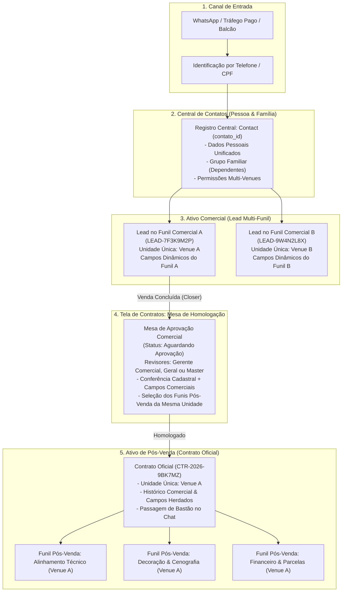
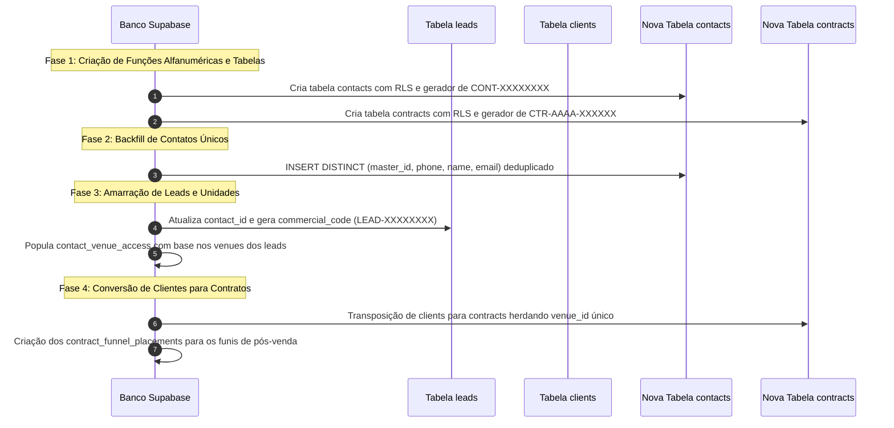
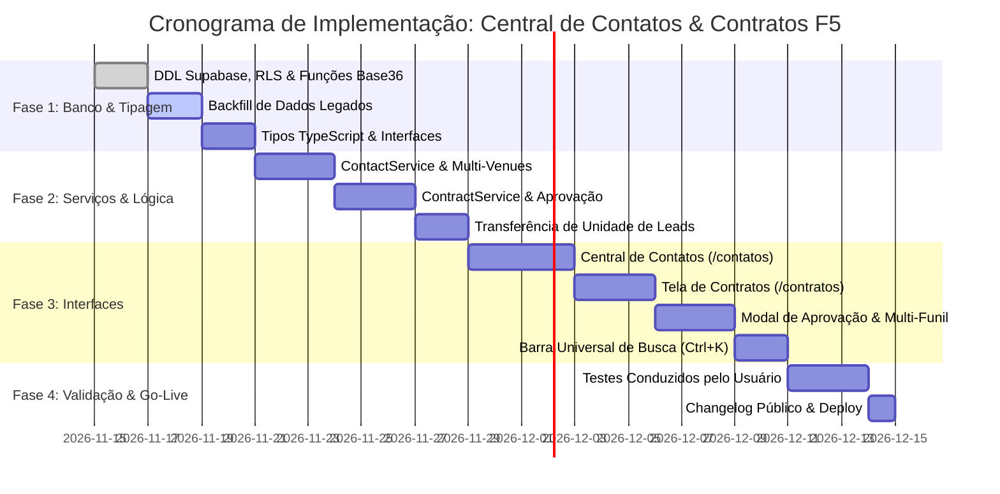

# F5 System • Plano de Ação Arquitetural: Central de Contatos, Leads Multi-Funil & Gestão Unificada de Contratos

> **Documento de Especificação Técnica & Executiva**  
> **Versão:** 1.1.0 • **Data:** Novembro de 2026  
> **Status:** Em Planejamento Aprovado (`/goal`)  
> **Alinhamento:** [F5_SYSTEM_MASTER.md](file:///c:/Users/--/OneDrive/Documents/Codex%20Projetos/Bonomo%20Festas%202/F5_SYSTEM_MASTER.md) • Regra Suprema de Isolamento Master (`master_id`) & Multi-Casas (`venues`).

---

## Sumário Executivo

Este plano de ação estabelece a reestruturação arquitetural do **F5 System** no tratamento de pessoas, oportunidades comerciais e entregas de contratos de eventos.

Historicamente, o sistema tratava cada entrada de telefone diretamente como um registro na tabela `leads`. Na conversão de venda, esse lead era **duplicado** para a tabela `clients`, gerando quebra de histórico, redundância de dados cadastrais, perda de rastreabilidade e impossibilidade de atender clientes recorrentes ou gerenciar múltiplos funis de pós-venda de forma coesa.

### Os Três Pilares da Nova Arquitetura
1. **Entidade Pessoa Única (`contacts`):** O número de telefone ou documento pertence a um **Contato**. O contato armazena todos os dados cadastrais (nome, telefone(s), e-mail, CPF, endereço, foto e grupo familiar/dependentes). Qualquer atualização cadastral reflete em tempo real em todas as frentes.
2. **Ativos Comerciais Independentes (`leads`):** O contato pode ser um lead em um ou múltiplos funis comerciais simultaneamente, carregando um código próprio (`LEAD-XXXXXXXX`), respostas de qualificação e campos comerciais dinâmicos daquele funil. **Regra de Ouro:** cada lead pertence a **uma única unidade (`venue_id`)**.
3. **Ativos Pós-Venda por Contrato (`contracts`):** A conversão comercial não cria um "cliente duplicado", mas sim homologa um **Contrato de Evento** (`CTR-AAAA-XXXXXX`). Um mesmo contato pode ter múltiplos contratos ao longo dos anos. Cada contrato pertence a **uma única unidade (`venue_id`)**, mas pode ser distribuído para múltiplos funis de pós-venda (Financeiro, Decoração, Alinhamento Técnico, Cerimonial) daquela mesma unidade.



---

## 1. Regras de Capacidade dos Identificadores (Escalabilidade Quase Infinita)

Para garantir que o F5 System **nunca atinja limites numéricos ou sofra estouro de sequencial**, todos os identificadores públicos utilizam codificação **alfanumérica de alta entropia** (base36 maiúscula: dígitos `0-9` e letras `A-Z`, gerados com checagem de unicidade por tenant):

| Entidade | Padrão do Código | Exemplo Real | Capacidade / Combinações Possíveis |
| :--- | :--- | :--- | :--- |
| **Contrato** | `CTR-AAAA-XXXXXX` | `CTR-2026-9BK7MZ` | **$36^6 \approx 2,17$ bilhões de contratos por ano** por Master |
| **Lead** | `LEAD-XXXXXXXX` | `LEAD-7F3K9M2P` | **$36^8 \approx 2,82$ trilhões de leads** por Master |
| **Contato** | `CONT-XXXXXXXX` | `CONT-4H8W2N9Q` | **$36^8 \approx 2,82$ trilhões de contatos** por Master |

> 🔒 **Garantia Técnica:** Mesmo redes com milhões de atendimentos simultâneos jamais esgotarão os códigos. A geração é feita por função de banco com fallback criptográfico e índice de unicidade estrito (`UNIQUE (master_id, code)`).

---

## 2. Diagnóstico do Modelo Atual vs. Novo Modelo F5 System

| Aspecto | Modelo Anterior (Legado) | Novo Modelo Arquitetural (F5 System) |
| :--- | :--- | :--- |
| **Ponto Central** | Tabela `leads` era a raiz de tudo. | Tabela `contacts` é a raiz de identidade da pessoa. |
| **Conversão de Venda** | Duplicação de registro de `leads` para `clients` com novo ID arbitrário. | Conversão gera um **Contrato** (`contracts`) vinculado ao contato. Zero duplicação. |
| **Campos Comerciais** | Campos fixos ou engessados que se perdiam no pós-venda. | **Campos Dinâmicos por Funil:** Os campos preenchidos no funil comercial acompanham integralmente o contrato fechado. |
| **Pós-Venda** | Um único funil de pós-venda amarrado ao `clients.stage_id`. | Distribuição do mesmo contrato para **múltiplos funis de pós-venda** (`contract_funnel_placements`), selecionados na aprovação. |
| **Grupo Familiar** | Nenhum suporte; mãe e debutante eram leads separados sem conexão. | Suporte nativo a grupos familiares e dependentes (`family_groups` e `contact_dependents`). Mensagens de familiares são reconhecidas no contexto do contrato. |
| **Mesa de Aprovação** | O próprio Closer convertia e mandava direto pro pós-venda sem conferência. | **Aba "Aguardando Aprovação" na Central de Contratos:** Exclusiva para `gerente_comercial`, `gerente_geral` e `master`. |
| **Escopo de Unidade** | Ambiguidade em leads multi-casas. | **Regra Estrita de Unidade Única:** Lead e Contrato pertencem a **uma única unidade**. Transferência possui fluxo assistido. |

---

## 3. Especificação do Banco de Dados (PostgreSQL / Supabase)

### 3.1. Função de Geração de Códigos Alfanuméricos
```sql
-- Gerador seguro de código alfanumérico base36
CREATE OR REPLACE FUNCTION public.generate_alphanumeric_code(prefix TEXT, length INT)
RETURNS TEXT AS $$
DECLARE
    chars TEXT := '0123456789ABCDEFGHIJKLMNOPQRSTUVWXYZ';
    result TEXT := '';
    i INT;
BEGIN
    FOR i IN 1..length LOOP
        result := result || substr(chars, floor(random() * length(chars) + 1)::int, 1);
    END LOOP;
    RETURN prefix || '-' || result;
END;
$$ LANGUAGE plpgsql;
```

### 3.2. Tabela: `contacts` (Central de Contatos)
Raiz única para dados pessoais do indivíduo no tenant Master.

```sql
CREATE TABLE public.contacts (
    id UUID PRIMARY KEY DEFAULT gen_random_uuid(),
    master_id UUID NOT NULL REFERENCES public.masters(id) ON DELETE RESTRICT,
    code TEXT NOT NULL, -- Ex: "CONT-4H8W2N9Q" (8 caracteres alfanuméricos)
    name TEXT NOT NULL,
    nickname TEXT,
    primary_phone TEXT NOT NULL,
    secondary_phone TEXT,
    email TEXT,
    cpf TEXT,
    rg TEXT,
    birth_date DATE,
    profile_picture_url TEXT,
    
    -- Endereço Completo
    postal_code TEXT,
    street TEXT,
    number TEXT,
    complement TEXT,
    neighborhood TEXT,
    city TEXT,
    state TEXT,

    -- Família e Metadados
    family_group_id UUID REFERENCES public.family_groups(id) ON DELETE SET NULL,
    relationship_role TEXT, -- Ex: "Pai", "Mãe", "Debutante", "Noivo", "Contratante", "Titular"
    notes TEXT,
    custom_fields JSONB DEFAULT '{}'::jsonb,
    
    -- Auditoria
    created_by UUID REFERENCES public.collaborators(id) ON DELETE SET NULL,
    updated_by UUID REFERENCES public.collaborators(id) ON DELETE SET NULL,
    created_at TIMESTAMPTZ NOT NULL DEFAULT timezone('utc'::text, now()),
    updated_at TIMESTAMPTZ NOT NULL DEFAULT timezone('utc'::text, now()),
    deleted_at TIMESTAMPTZ
);

-- Índices de Performance e Unicidade
CREATE UNIQUE INDEX idx_contacts_master_primary_phone ON public.contacts (master_id, primary_phone) WHERE deleted_at IS NULL;
CREATE UNIQUE INDEX idx_contacts_master_code ON public.contacts (master_id, code);
CREATE INDEX idx_contacts_master_cpf ON public.contacts (master_id, cpf) WHERE deleted_at IS NULL;
CREATE INDEX idx_contacts_master_name ON public.contacts (master_id, name);
```

### 3.3. Tabela: `contact_venue_access` (Isolamento Multi-Casas de Contatos)
Mapeia a quais casas de festa (`venues`) o contato pertence por histórico de atendimento.

```sql
CREATE TABLE public.contact_venue_access (
    id UUID PRIMARY KEY DEFAULT gen_random_uuid(),
    master_id UUID NOT NULL REFERENCES public.masters(id) ON DELETE CASCADE,
    contact_id UUID NOT NULL REFERENCES public.contacts(id) ON DELETE CASCADE,
    venue_id UUID NOT NULL REFERENCES public.venues(id) ON DELETE CASCADE,
    first_interaction_at TIMESTAMPTZ NOT NULL DEFAULT timezone('utc'::text, now()),
    last_interaction_at TIMESTAMPTZ NOT NULL DEFAULT timezone('utc'::text, now()),
    origin_source_id UUID REFERENCES public.lead_sources(id) ON DELETE SET NULL,
    created_at TIMESTAMPTZ NOT NULL DEFAULT timezone('utc'::text, now()),
    CONSTRAINT uq_contact_venue UNIQUE (contact_id, venue_id)
);

CREATE INDEX idx_contact_venue_venue_id ON public.contact_venue_access (venue_id, contact_id);
```

### 3.4. Tabelas: `family_groups` & `contact_dependents` (Grupo Familiar)
Permite conectar mãe, debutante, pai e patrocinador sob o mesmo grupo familiar.

```sql
CREATE TABLE public.family_groups (
    id UUID PRIMARY KEY DEFAULT gen_random_uuid(),
    master_id UUID NOT NULL REFERENCES public.masters(id) ON DELETE CASCADE,
    name TEXT NOT NULL, -- Ex: "Família Albuquerque Silva"
    primary_contact_id UUID REFERENCES public.contacts(id) ON DELETE SET NULL,
    notes TEXT,
    created_at TIMESTAMPTZ NOT NULL DEFAULT timezone('utc'::text, now())
);

CREATE TABLE public.contact_dependents (
    id UUID PRIMARY KEY DEFAULT gen_random_uuid(),
    master_id UUID NOT NULL REFERENCES public.masters(id) ON DELETE CASCADE,
    parent_contact_id UUID NOT NULL REFERENCES public.contacts(id) ON DELETE CASCADE,
    dependent_contact_id UUID NOT NULL REFERENCES public.contacts(id) ON DELETE CASCADE,
    kinship TEXT NOT NULL, -- "Filho(a) / Debutante", "Cônjuge", "Mãe", "Pai", "Responsável Financeiro"
    created_at TIMESTAMPTZ NOT NULL DEFAULT timezone('utc'::text, now()),
    CONSTRAINT uq_contact_dependent UNIQUE (parent_contact_id, dependent_contact_id)
);
```

### 3.5. Atualização da Tabela: `leads` (Ativos Comerciais com Unidade Única)
A tabela `leads` ganha referência obrigatória ao `contact_id`, código alfanumérico e unidade única estrita (`venue_id NOT NULL`).

```sql
-- Alteração incremental na tabela leads existente
ALTER TABLE public.leads
    ADD COLUMN IF NOT EXISTS contact_id UUID REFERENCES public.contacts(id) ON DELETE RESTRICT,
    ADD COLUMN IF NOT EXISTS commercial_code TEXT, -- Ex: "LEAD-7F3K9M2P"
    ADD COLUMN IF NOT EXISTS custom_fields_data JSONB DEFAULT '{}'::jsonb;

-- Garantia de código único alfanumérico
CREATE UNIQUE INDEX IF NOT EXISTS idx_leads_master_commercial_code ON public.leads (master_id, commercial_code);
CREATE INDEX IF NOT EXISTS idx_leads_contact_id ON public.leads (contact_id);
CREATE INDEX IF NOT EXISTS idx_leads_venue_id ON public.leads (venue_id);
```

### 3.6. Tabela: `contracts` (Ativos Contratuais com Unidade Única & Campos Comerciais Herdados)
Formaliza o contrato de prestação de serviços com seus campos comerciais herdados dinamicamente do funil de origem.

```sql
CREATE TABLE public.contracts (
    id UUID PRIMARY KEY DEFAULT gen_random_uuid(),
    master_id UUID NOT NULL REFERENCES public.masters(id) ON DELETE RESTRICT,
    contract_code TEXT NOT NULL, -- Ex: "CTR-2026-9BK7MZ"
    contact_id UUID NOT NULL REFERENCES public.contacts(id) ON DELETE RESTRICT,
    origin_lead_id UUID REFERENCES public.leads(id) ON DELETE SET NULL,
    origin_funnel_id UUID REFERENCES public.commercial_funnels(id) ON DELETE SET NULL,
    venue_id UUID NOT NULL REFERENCES public.venues(id) ON DELETE RESTRICT, -- REGRA: UNIDADE ÚNICA
    
    -- Dados do Evento
    event_type TEXT NOT NULL, -- "15_anos", "casamento", "infantil", "corporativo"
    event_title TEXT NOT NULL, -- Ex: "15 Anos Manuella Albuquerque"
    event_date DATE,
    guest_count INTEGER,
    package_name TEXT,
    
    -- Campos Comerciais Dinâmicos Herdados do Funil de Origem
    commercial_fields JSONB DEFAULT '{}'::jsonb, -- Guarda todos os campos preenchidos no funil
    
    -- Valores Financeiros do Contrato
    total_amount NUMERIC(12, 2) NOT NULL DEFAULT 0.00,
    payment_terms JSONB DEFAULT '{}'::jsonb,
    
    -- Mesa de Aprovação & Governança (Exclusiva para Gerente Comercial, Geral ou Master)
    approval_status TEXT NOT NULL DEFAULT 'pending_approval', 
    -- 'pending_approval' | 'approved' | 'rejected' | 'canceled' | 'completed'
    submitted_by UUID REFERENCES public.collaborators(id) ON DELETE SET NULL,
    submitted_at TIMESTAMPTZ NOT NULL DEFAULT timezone('utc'::text, now()),
    approved_by UUID REFERENCES public.collaborators(id) ON DELETE SET NULL,
    approved_at TIMESTAMPTZ,
    rejection_reason TEXT,
    
    -- Seleção dos Funis Pós-Venda Destino (Restritos à mesma venue_id)
    target_pos_sale_funnel_ids UUID[] DEFAULT '{}'::uuid[],
    
    -- Passagem de Bastão & Documentação
    handover_notes TEXT,
    contract_file_url TEXT,
    attachments JSONB DEFAULT '[]'::jsonb,
    
    created_at TIMESTAMPTZ NOT NULL DEFAULT timezone('utc'::text, now()),
    updated_at TIMESTAMPTZ NOT NULL DEFAULT timezone('utc'::text, now())
);

CREATE UNIQUE INDEX idx_contracts_master_code ON public.contracts (master_id, contract_code);
CREATE INDEX idx_contracts_contact_id ON public.contracts (contact_id);
CREATE INDEX idx_contracts_venue_id ON public.contracts (venue_id);
CREATE INDEX idx_contracts_approval_status ON public.contracts (master_id, approval_status);
```

### 3.7. Tabela: `contract_funnel_placements` (Multi-Funil Pós-Venda na Mesma Unidade)
Registra a presença do contrato nos funis de pós-venda homologados na aprovação.

```sql
CREATE TABLE public.contract_funnel_placements (
    id UUID PRIMARY KEY DEFAULT gen_random_uuid(),
    master_id UUID NOT NULL REFERENCES public.masters(id) ON DELETE CASCADE,
    contract_id UUID NOT NULL REFERENCES public.contracts(id) ON DELETE CASCADE,
    funnel_id UUID NOT NULL REFERENCES public.commercial_funnels(id) ON DELETE RESTRICT,
    stage_id UUID NOT NULL REFERENCES public.funnel_stages(id) ON DELETE RESTRICT,
    assigned_to UUID REFERENCES public.collaborators(id) ON DELETE SET NULL,
    status TEXT NOT NULL DEFAULT 'in_progress', -- 'in_progress' | 'completed' | 'on_hold'
    completed_at TIMESTAMPTZ,
    notes TEXT,
    order_index INTEGER DEFAULT 0,
    created_at TIMESTAMPTZ NOT NULL DEFAULT timezone('utc'::text, now()),
    updated_at TIMESTAMPTZ NOT NULL DEFAULT timezone('utc'::text, now()),
    CONSTRAINT uq_contract_funnel UNIQUE (contract_id, funnel_id)
);

CREATE INDEX idx_contract_placements_funnel_stage ON public.contract_funnel_placements (funnel_id, stage_id);
CREATE INDEX idx_contract_placements_assigned ON public.contract_funnel_placements (assigned_to);
```

---

## 4. Matriz de Cargos, Governança & Regras de Acesso (RBAC)

Para atender à operação comercial, supervisão de contratos e pós-venda, a matriz de perfis é estruturada da seguinte forma:

| Cargo (`role`) | Central de Contatos | Leads / CRM Comercial | Mesa de Aprovação de Contratos | Funis Pós-Venda | Exclusão de Contatos |
| :--- | :---: | :---: | :---: | :---: | :---: |
| **`master`** | Total (Todas as unidades da rede) | Total (Todos os funis e unidades) | **Aprovação e Homologação Global** | Total (Todos os funis) | Permitida (Se não houver ativos) |
| **`gerente_geral`** | Total nas unidades atribuídas | Total nas unidades atribuídas | **Aprovação e Homologação nas Casas** | Total nas unidades atribuídas | Permitida (Se não houver ativos) |
| **`gerente_comercial`** | Consulta e edição nas unidades | Total nos funis comerciais | **Aprovação e Homologação Comercial** | Apenas leitura | Bloqueada |
| **`gerente_pos_venda`** | Consulta e edição nas unidades | Apenas leitura de fechamento | Visualização (Leitura de Contratos) | **Gestão Total do Pós-Venda** | Bloqueada |
| **`comercial` (SDR/Closer)** | Visualização de seus contatos | Edição de leads atribuídos | Submissão de propostas (Sem aprovação) | Sem acesso | Bloqueada |
| **`pos_venda`** | Visualização de clientes/contratos | Sem acesso | Sem acesso | Edição nos funis atribuídos | Bloqueada |

---

## 5. Fluxos Operacionais & Regras de Negócio

### 5.1. Regra de Unidade Única e Transferência de Leads entre Unidades
1. **Unidade Única:** Todo lead pertence estritamente a uma única unidade (`venue_id`).
2. **Transferência de Unidade:**
   - O operador ou gerente aciona a ação **"Transferir Unidade do Lead"**:
     1. O sistema solicita a escolha da **Unidade de Destino**.
     2. **Verificação de Permissões do Usuário:**
        - **Cenário A (Usuário tem acesso aos funis da unidade de destino):** O modal exibe os funis comerciais disponíveis naquela unidade para que o usuário escolha exatamente o funil e a etapa de entrada.
        - **Cenário B (Usuário NÃO tem acesso aos funis da unidade de destino):** O sistema exibe aviso informativo e transfere o lead automaticamente para o **primeiro funil de entrada padrão** daquela unidade, atribuindo o lead à fila geral de triagem daquela casa.
     3. O histórico comercial anterior, anotações e atividades são preservados. O contato ganha o vínculo da nova casa em `contact_venue_access`.

### 5.2. Tela de Contratos & Mesa de Aprovação Gerencial (`/admin/contratos`)
A tela de Contratos é unificada em **duas abas principais**:

```
+---------------------------------------------------------------------------------------------------------------+
| [Gestão de Contratos]               [Filtro: Todas as Casas v] [Buscar CTR-..., Cliente, CPF]  [+ Novo Contrato] |
+---------------------------------------------------------------------------------------------------------------+
|  (Badge: 3) Contratos para Aprovação  |   Contratos Aprovados (Vigentes)                                      |
+---------------------------------------------------------------------------------------------------------------+
```

#### Modal de Homologação de Contrato (Aprovação por Gerente Comercial, Geral ou Master):
Ao abrir um contrato pendente de aprovação, o modal exibe 3 blocos analíticos:
1. **Dados Cadastrais do Contato/Cliente:**
   - Nome completo, Telefones, CPF, RG, Endereço completo, e-mail.
2. **Dados Comerciais & Campos Dinâmicos Herdados do Funil:**
   - Exibe todos os dados preenchidos pelo Closer durante a negociação no funil comercial de origem.
   - Os campos personalizados configurados no funil (ex: data do evento, profissão, estilo de buffet, perguntas customizadas) são exibidos dinamicamente com seus valores preenchidos.
3. **Distribuição para Funis de Pós-Venda:**
   - **Regra Rígida de Unidade:** O contrato só pode ser distribuído para funis de pós-venda **da mesma unidade física (`venue_id`) do contrato**.
   - É renderizada uma listagem interativa de múltipla seleção:
     - `[X] Funil de Alinhamento Técnico & Debutante (Espaço Rio Lounge)`
     - `[X] Funil de Decoração & Cenografia (Espaço Rio Lounge)`
     - `[X] Funil Financeiro & Pagamentos (Espaço Rio Lounge)`
   - O gerente pode marcar ou desmarcar quais funis receberão o contrato.
4. **Ações de Decisão:**
   - `[Homologar Contrato e Liberar Pós-Venda]` (visível apenas para `gerente_comercial`, `gerente_geral` ou `master`).
   - `[Solicitar Ajuste ao Comercial]` (retorna o card para o Closer com anotação do que corrigir).

---

## 6. Especificação de Telas (UI/UX)

### 6.1. Central de Contatos (`/admin/contatos`)
Layout bilateral (split view responsivo):
- **Coluna Esquerda:** Lista indexada de contatos com busca rápida, avatar, telefones e tags de unidades e contratos ativos.
- **Coluna Direita (Ficha do Contato):**
  - **Bloco Superior:** Perfil completo, dados pessoais, endereço e grupo familiar (dependentes vinculados com suas relações de parentesco).
  - **Abas de Ativos:**
    - `Oportunidades Comerciais`: Histórico de leads em funis comerciais (com código `LEAD-XXXXXXXX`, unidade e status).
    - `Contratos de Eventos`: Contratos assinados (com código `CTR-AAAA-XXXXXX`, valores, datas e links diretos para os funis de pós-venda).
    - `Histórico e Linha do Tempo`: Atividades unificadas e mensagens de WhatsApp.

### 6.2. Barra de Pesquisa Universal Overlay (`Ctrl + K`)
- Modal amplo centralizado na **Área de Conteúdo**.
- Busca instantânea e unificada em tempo real por:
  - 👤 **Contatos:** Código `CONT-XXXXXXXX`, Nome, Telefone, CPF.
  - 📋 **Contratos:** Código `CTR-AAAA-XXXXXX`, Nome do Evento, Homenageado.
  - 🎯 **Leads:** Código `LEAD-XXXXXXXX`, Nome da Oportunidade.
  - 👨‍👩‍👧 **Dependentes:** Nome do dependente ou participante do grupo familiar.

---

## 7. Estratégia de Migração de Dados (Zero-Downtime & Backfill)



---

## 8. Cronograma Fatiado em Fases (Sprints de Entrega)



---

## 9. Critérios de Aceite e Validação de Sucesso

1. **Escalabilidade Alfanumérica:** Códigos gerados seguem `CONT-XXXXXXXX`, `LEAD-XXXXXXXX` e `CTR-AAAA-XXXXXX` em base36 com garantia de não esgotamento.
2. **Unidade Única:** Todo lead e todo contrato pertencem estritamente a um único `venue_id`.
3. **Distribuição Pós-Venda Restrita à Unidade:** O modal de aprovação só permite selecionar funis de pós-venda da mesma unidade física do contrato.
4. **Campos Dinâmicos Herdados:** Todos os campos preenchidos durante a qualificação no funil comercial acompanham o contrato aprovado.
5. **Permissão Estrita de Homologação:** Apenas `gerente_comercial`, `gerente_geral` e `master` conseguem aprovar contratos e enviá-los ao pós-venda.
6. **Transferência de Leads Inteligente:** Se o usuário não tem acesso aos funis da unidade de destino, o lead cai automaticamente no primeiro funil de entrada daquela casa.
7. **Isolamento Absoluto Master:** Zero vazamento entre tenants (`master_id`).
8. **UI Sem Emojis:** Interface elegante utilizando exclusivamente ícones da biblioteca `lucide-react`.

---
*Documento homologado para execução no F5 System.*
