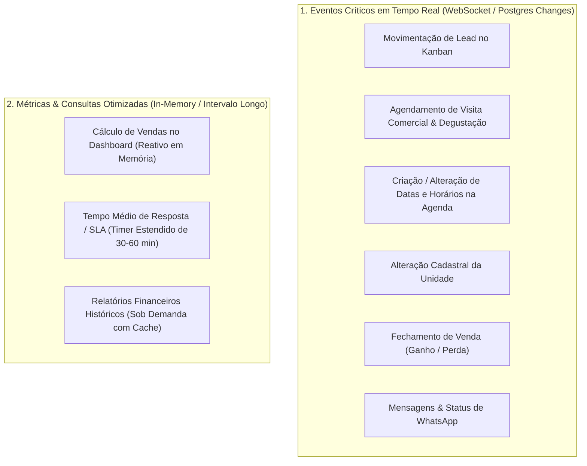
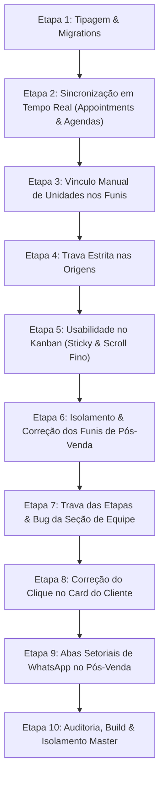

# Plano de Ação Estrutural • F5 System
## Simplificação de Funis por Unidade, Usabilidade no Kanban, Isolamento no Pós-Venda, Abas Setoriais de WhatsApp & Sincronização em Tempo Real

> **Documento Oficial de Planejamento Técnico Consolidado**  
> Data: 14 de Outubro de 2026  
> Escopo: Funis, Unidades, Kanban, Pós-Venda, WhatsApp Workspace & Supabase Realtime  

---

### 1. Resumo Executivo & Diagnóstico

O presente plano visa solucionar inconsistências decorrentes de inferências automáticas e acoplamentos indiretos entre Funis, Unidades e Origens, modernizar a experiência visual do Kanban, implementar as **Abas Setoriais de WhatsApp no Pós-Venda** e consolidar a **Sincronização em Tempo Real (Realtime)** entre colaboradores sem sobrecarregar a cota do Supabase.

#### Pilares Fundamentais:
1. **Vínculo Estritamente Manual (Zero Heurística):** Fim dos pertencimentos automáticos baseados em origens ou leads de outras unidades. O gestor define manualmente a quais unidades o funil pertence.
2. **Nomenclatura Oficial:** Substituição de *"Casa de Festa"* por **"Unidade"** em todo o ecossistema da aplicação.
3. **Origens com Trava Estrita:** O seletor de funis de uma Origem só lista funis vinculados àquela mesma unidade.
4. **Usabilidade no Kanban (Sticky Header & Scroll Elegante):** Cabeçalho de etapas fixo no topo ao rolar a página verticalmente; scroll individual por coluna com barra ultrafina e minimalista (clara no tema light e escura/translúcida no dark).
5. **Isolamento Total dos Funis de Pós-Venda:** Cada funil de Pós-Venda (ex.: *Decor* vs. *Sucesso do Cliente*) exibe estritamente os seus clientes e as suas próprias etapas cadastradas.
6. **Regras de Pipeline (Entrada, Ganho e Perda):** Caixa de Entrada sempre na posição inicial (ativada por padrão no comercial, desativada no pós-venda, com persistência do toggle corrigida no banco). Ganho e Perda sempre nas duas últimas posições (sem reordenação). No Pós-Venda, os nomes de Ganho e Perda podem ser customizados (ex.: *"Festa Realizada"* e *"Contrato Cancelado"*).
7. **Correção do Clique no Cliente (Pós-Venda):** Abrir fluidamente o Workspace/Inspector completo sem tela branca ou travamento.
8. **Novo WhatsApp com Abas Setoriais no Pós-Venda (Conforme imagem oficial):**
   - Barra de abas no topo da conversa: `[ Geral ] [ Decoração ] [ Sucesso do Cliente ] [ Produção ] [ + ]`.
   - Criação de novos canais setoriais via `[ + ]` com **número exclusivo de WhatsApp** e **controle de permissões por colaborador**.
   - Histórico e SLA independentes por canal.
9. **Sincronização Visual em Tempo Real (Supabase Realtime):**
   - Garantir que movimentação de leads, agendamento de visitas/degustações, alterações de configuração de unidades, criação de horários na agenda e fechamento de vendas reflitam visualmente na tela de todos os colaboradores instantaneamente, sem necessidade de F5 e sem polling agressivo que sobrecarregue o banco de dados.

---

### 2. Matriz de Sincronização em Tempo Real vs. Atualizações Otimizadas

Para garantir fluidez absoluta sem esgotar o pool de conexões ou a cota de egress do Supabase, o sistema divide as atualizações em duas categorias:



#### Lista Detalhada de Ações em Tempo Real:

| Ação do Usuário | Tabela Envolvida | Comportamento em Tempo Real na Tela | Otimização Anti-Sobrecarga |
| :--- | :--- | :--- | :--- |
| **Mover Lead de Etapa** (Drag & Drop) | `leads` | O card muda de coluna imediatamente na tela de todos os colaboradores que estão no mesmo funil/unidade. | Atualização cirúrgica in-memory no `AdminStateContext` (já implementada, garantindo propagação visual imediata). |
| **Agendar/Reagendar Visita ou Degustação** | `appointments` | A nova visita/degustação surge no calendário unificado e nos indicadores do lead instantaneamente. | **Correção necessária no listener:** atualmente atualizava apenas `debutantes`. Deve atualizar cirurgicamente `appointments` via `appointmentService.getAll()`. |
| **Criar/Modificar Horários na Agenda da Unidade** | `venue_agenda_configs` | Novos horários/dias disponíveis ficam imediatamente visíveis no seletor de agendamento de todos os atendentes. | Adicionar listener em `venue_agenda_configs` com debounce de 200ms. |
| **Alterar Configuração da Unidade** | `venues` | Mudança de nome, capacidade, horários ou status da unidade reflete na hora no seletor global do topo. | Listener já existente em `venues`, sincronizando `setVenues`. |
| **Fechamento de Venda (Ganho / Perda)** | `leads` + `clients` | O lead é marcado como ganho, entra como cliente no Pós-Venda e o card de métricas de vendas do Dashboard incrementa na hora. | O Dashboard recalcula os totais reativamente a partir dos arrays `leads` e `clients` locais, sem disparar query pesada no banco. |
| **Mensagens e Atendimento WhatsApp** | `chat_messages` / SSE | Mensagens recebidas/enviadas e contadores de não lidas atualizam na hora na caixa de entrada. | Utilização do canal dedicado de mensagens com debounce de digitação e streaming. |

---

### 3. Comparativo Estrutural: Como é Hoje vs. Como Vai Passar a Ser

| Dimensão | Como é Hoje | Como Vai Passar a Ser |
| :--- | :--- | :--- |
| **Vínculo Unidade ↔ Funil** | Inferência automática por origens conectadas e leads. Funis globais misturados. Termo "Casa de Festa". | **Vínculo Manual:** O gestor seleciona as unidades (`sharedVenueIds`). Sem vínculo = visível apenas ao Master. Termo padrão: **"Unidade"**. |
| **Seleção de Funis na Origem** | Lista todos os funis globais ou de todas as casas. | **Trava Estrita:** Lista estritamente funis onde a unidade da origem está contida em `sharedVenueIds`. |
| **Navegação & Scroll no Kanban** | Cabeçalho some ao rolar a tela verticalmente; rolagem de página única e desordenada. | **Sticky Header:** Cabeçalho de etapas fixo no topo. Cada coluna tem seu scroll vertical com barra elegante, ultrafina (4px) e discreta. |
| **Pós-Venda (Sucesso do Cliente)** | Funis exibem os mesmos clientes e etapas engessadas (`STAGE_COLUMNS`). Ao clicar no card, não abre. | **Isolamento Real:** Clientes filtrados por `c.funnelId === currentFunnel.id`, renderizando `funnel.stages`. Clique abre o Workspace/Inspector sem erros. |
| **Etapas Fixas (Entrada, Ganho, Perda)** | Etapas podiam ser reordenadas; toggle de entrada no pós-venda não salvava; seção de equipe sumia na configuração. | **Posições Travadas:** Entrada (pos 0), Ganho e Perda (últimas posições). Toggle de entrada persiste no banco. Nomes de Ganho/Perda customizáveis no pós-venda. Seção de equipe visível de forma independente. |
| **WhatsApp no Pós-Venda** | Canal único e misturado. | **Abas Setoriais:** Canal `Geral` + Canais criados via `[ + ]` (Decoração, Produção, etc.), cada um com **número exclusivo de WhatsApp**, restrição por colaborador e SLA próprio. |
| **Atualização em Tempo Real** | Listener de `appointments` atualizava tabela errada (`debutantes`); `venue_agenda_configs` não possuía listener; dependia de recarregar a tela (F5). | **Sincronização Completa:** Correção do listener de `appointments`, adição de `venue_agenda_configs` e atualização reativa de métricas de vendas no Dashboard. |

---

### 4. Roteiro Passo a Passo de Execução Técnica



---

#### Etapa 1: Camada de Tipagem e Banco de Dados (`types/admin.ts` & Migrations)
- **Objetivo:** Estabelecer a persistência de canais setoriais e configurações de funil.
- **Arquivos:**
  - `src/types/admin.ts`
  - `supabase/migrations/20261014130000_post_sale_channels_and_funnel_fixes.sql`
- **Alterações:**
  - Tipagem `PostSaleChannelConfig`:
    ```typescript
    export interface PostSaleChannelConfig {
      id: string; // ex: 'decoracao', 'producao'
      name: string; // 'Decoração', 'Produção'
      icon?: string;
      color?: string;
      instanceId: string; // Instância exclusiva de WhatsApp
      allowedCollaboratorIds: string[]; // Colaboradores autorizados
      isGeneral?: boolean;
    }
    ```
  - Adicionar `postSaleChannels?: PostSaleChannelConfig[]` em `CommercialFunnel`.
  - Adicionar `channelId?: string` nas mensagens de WhatsApp (`WhatsAppMessage`).
  - Assegurar persistência do toggle `enableInboxStage` e dos nomes customizados de etapas (`postSaleCustomStageNames`).

#### Etapa 2: Sincronização em Tempo Real (Supabase Realtime no `AdminStateContext.tsx`)
- **Objetivo:** Corrigir listeners desatualizados e adicionar tabelas faltantes para atualização instantânea na tela de todos os colaboradores.
- **Arquivos:**
  - `src/context/AdminStateContext.tsx`
- **Alterações:**
  - **Correção em `appointments`:** Modificar o handler de `postgres_changes` da tabela `appointments` para chamar `appointmentService.getAll()` e atualizar `setAppointments` (atualmente ele só chamava debutantes).
  - **Adição de `venue_agenda_configs`:** Incluir listener na tabela `venue_agenda_configs` para sincronizar `setAgendaConfigs` em tempo real sempre que novas datas ou horários forem criados ou modificados.
  - **Garantia de propagação no Kanban:** Confirmar que eventos de `UPDATE` em `leads` acionem re-renderização suave das colunas sem flickering.
  - **Reatividade do Dashboard:** Certificar que os cards de Vendas Fechadas e Visitas Agendadas leiam do estado unificado reativo, atualizando na hora em que o evento ocorrer.

#### Etapa 3: Vínculo Manual de Unidades nos Funis & Nomenclatura
- **Objetivo:** Eliminar deduções automáticas e padronizar o termo "Unidade".
- **Arquivos:**
  - `src/components/admin/AdminFunnelSettingsView.tsx`
  - `src/components/admin/AdminCreatePostSaleFunnelModal.tsx`
  - `src/components/admin/AdminCreateCommercialFunnelModal.tsx`
- **Alterações:**
  - Remover `getLinkedVenuesForFunnel` que deduzia casas a partir de origens e leads.
  - Seletor limpo de checkboxes com as unidades pertencentes ao Master.
  - Sinalizar que se nenhuma unidade for selecionada, o funil será acessível somente ao Master.
  - Substituição consistente de textos "Casa de Festa" por "Unidade".

#### Etapa 4: Trava Estrita de Seleção de Funis na Origem
- **Objetivo:** Impedir que origens de uma unidade sejam atreladas a funis de outra unidade.
- **Arquivos:**
  - `src/components/admin/AdminSourceModal.tsx`
  - `src/components/admin/AdminSourceEditorView.tsx`
- **Alterações:**
  - Restringir o dropdown de funis: exibir apenas os funis onde a unidade da origem está incluída em `sharedVenueIds`.
  - Exibir alerta amigável caso a unidade ainda não possua funis compatíveis.

#### Etapa 5: Usabilidade no Kanban (Sticky Header & Scroll Fino)
- **Objetivo:** Evitar perda de orientação nas colunas ao rolar a página e garantir rolagem independente e discreta.
- **Arquivos:**
  - `src/components/admin/AdminCrmWorkspaceView.tsx`
  - `src/components/admin/AdminPostSaleKanbanView.tsx`
- **Alterações:**
  - Cabeçalho das etapas configurado com `position: sticky; top: 0; z-index: 10` e background sólido adaptativo.
  - Cada coluna com `overflow-y: auto` e scrollbar estilizada:
    - Espessura: 4px.
    - Modo Claro: barra em tom cinza suave translúcido (`rgba(0,0,0,0.12)`).
    - Modo Escuro: barra em tom escuro translúcido discreto (`rgba(255,255,255,0.12)`).

#### Etapa 6: Isolamento Pleno dos Funis de Pós-Venda
- **Objetivo:** Resolver o problema de funis distintos exibirem os mesmos clientes e etapas.
- **Arquivos:**
  - `src/components/admin/AdminPostSaleKanbanView.tsx`
- **Alterações:**
  - Desativar a constante estática `STAGE_COLUMNS`.
  - Renderizar dinamicamente as colunas com base nas etapas do funil ativo (`currentFunnel.stages`).
  - Filtrar estritamente a lista de clientes por `c.funnelId === currentFunnel.id`.

#### Etapa 7: Trava das Etapas Fixas e Correção da Seção de Equipe
- **Objetivo:** Bloquear a movimentação indevida de etapas essenciais e corrigir a visibilidade da equipe.
- **Arquivos:**
  - `src/components/admin/AdminFunnelSettingsView.tsx`
- **Alterações:**
  - Trava de drag-and-drop: Caixa de Entrada sempre na posição 0; Ganho e Perda sempre nas duas últimas posições.
  - Permitir a customização de nomes de Ganho e Perda no pós-venda.
  - Corrigir a persistência do toggle da Caixa de Entrada no banco de dados.
  - Desacoplar a visibilidade da seção de Equipe do toggle da etapa de entrada.

#### Etapa 8: Correção do Clique no Card do Cliente no Pós-Venda
- **Objetivo:** Garantir abertura imediata e sem travamentos da ficha e workspace do cliente.
- **Arquivos:**
  - `src/components/admin/AdminPostSaleKanbanView.tsx`
  - `src/components/admin/AdminClientInspector.tsx`
- **Alterações:**
  - Tratar o estado do cliente selecionado sem dependências nulas que gerem tela branca.
  - Suportar visualização do workspace completo para atendimento de pós-venda.

#### Etapa 9: Abas Setoriais de WhatsApp no Pós-Venda
- **Objetivo:** Implementar canais específicos de atendimento com isolamento por setor e número dedicado.
- **Arquivos:**
  - `src/components/admin/AdminWhatsAppWorkspaceView.tsx`
  - `src/components/admin/AdminCreatePostSaleChannelModal.tsx`
- **Alterações:**
  - Renderizar a barra de abas no topo da conversa: `[ Geral ] [ Decoração ] [ Sucesso do Cliente ] [ Produção ] [ + ]`.
  - Modal para criação de novo canal com definição de:
    - Nome, ícone e cor do canal.
    - Instância exclusiva de WhatsApp (número que não pode ser reutilizado em outro canal setorial do mesmo funil).
    - Colaboradores com permissão de acesso.
  - Filtro de mensagens por canal (`channelId`):
    - Colaboradores autorizados só visualizam e enviam mensagens no canal a que pertencem.
    - Gerentes da unidade e Masters possuem visão e acesso a todos os canais.
  - SLA e controle de pendências individuais por aba (botão "Encerrar Conversa" atuando no canal ativo).

#### Etapa 10: Auditoria, Build e Validação de Isolamento Master
- **Objetivo:** Garantir integridade de compilação e segurança de dados.
- **Validações:**
  - Execução de `npm run build` para garantir zero erros de TypeScript.
  - Verificação do cumprimento absoluto da regra de isolamento por `master_id`.
  - Zero uso de emojis (uso exclusivo de `lucide-react`).

---

### 5. Critérios de Aceite Consolidados
- [ ] Quando um colaborador agenda uma visita ou degustação, a agenda dos demais colaboradores é atualizada visualmente na hora (sem F5).
- [ ] Quando um lead é movido de etapa no Kanban, a movimentação reflete em tempo real na tela dos outros colaboradores.
- [ ] Novas datas e horários na agenda da unidade atualizam imediatamente nos seletores de agendamento de toda a equipe.
- [ ] Fechamento de vendas atualiza o total no Dashboard de forma instantânea e reativa.
- [ ] O gestor vincula funis manualmente às unidades, sem inferências automáticas.
- [ ] O cadastro de origens restringe a escolha apenas a funis da respectiva unidade.
- [ ] O Kanban possui cabeçalho de etapas fixo (sticky) e barras de scroll individuais ultrafinas (4px).
- [ ] Os funis de Pós-Venda funcionam de forma 100% individual (clientes e etapas independentes).
- [ ] As etapas Entrada, Ganho e Perda possuem posições invioláveis, e a seção de equipe opera normalmente.
- [ ] O clique no card do cliente no pós-venda abre o Workspace sem travamento.
- [ ] As abas setoriais de WhatsApp operam com números dedicados e isolamento estrito por colaborador.
- [ ] `npm run build` passa com 100% de sucesso.
