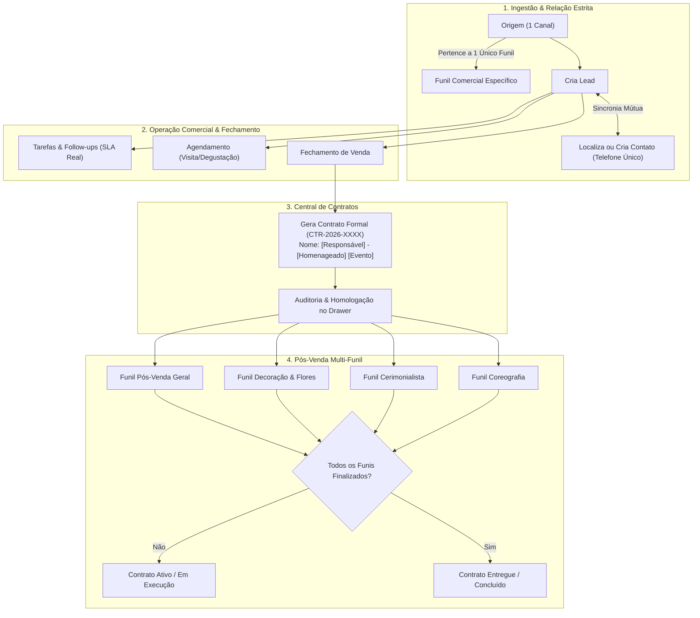

# Plano Mestre de Ação: Refino Operacional, CRM Básico e Nova Arquitetura de Pós-Venda

> **Objetivo:** Estabelecer segurança operacional irrestrita no F5 System para que a equipe possa operar o sistema em produção imediatamente no Pós-Venda e CRM, sem falhas, sem vazamento de termos técnicos e com uma experiência visual profissional e fluida.

---

## 1. Visão Geral e Diagnóstico das Dores

O F5 System atingiu um estágio crítico de transição: para que o cliente coloque sua equipe para operar diariamente (começando pelo **Pós-Venda**, setor onde não há risco de perda imediata de vendas comerciais), o sistema precisa garantir:
1. **Confiança Cega no Básico:** Follow-ups com prazos e status reais, histórico de mídias fluido e agendamentos confiáveis.
2. **Origens & Funis Sem Confusão:** Uma origem pertence a **apenas um funil comercial** (relação estrita 1:N), eliminando seleções duplicadas de números/instâncias.
3. **Criação & Sincronização Lead <-> Contato:** Entrada automática de lead cria ou conecta ao contato único pelo telefone; alterações de dados no lead refletem no contato e vice-versa.
4. **Revolução no Pós-Venda (Cards de Contrato & Multi-Funis):** O pipeline de pós-venda deixa de exibir cards genéricos de "clientes" e passa a operar sobre **Contratos**. Um contrato pode transitar por múltiplos funis simultaneamente (Pós-Venda Geral, Decoração, Cerimonial, Coreografia) e sua conclusão é atrelada ao fechamento de todos os funis ativos.
5. **Nomenclatura Padrão de Contratos:** Padronização obrigatória em `[Responsável/Decisor] - [Homenageado/Aniversariante] [Tipo de Evento]`.
6. **Erradicação de Elementos Nativos e Vaza-Infraestrutura:** Eliminação de 121 `alert()`/`confirm()` nativos do navegador em favor de Toasts modernos (**Sonner**) e limpeza de qualquer menção a "R2", "Cloudflare" ou "banco" na UI.
7. **Dashboard Moderno:** Adoção do arsenal open-source (**Tremor Raw**, **Apache ECharts**, **TanStack Table**) para métricas executivas reais.

---

## 2. As 7 Frentes de Execução Detalhadas

### 🎯 Frente 1: Conexão Estrita Origens ➔ Funis e Sincronização Lead-Contato
* **Proprietário:** Barney Stinson (Backend) & Lily Aldrin (Frontend)
* **Status Atual:** Origens podem ser selecionadas para múltiplos funis e vinculadas de forma ambígua, gerando duplicidade de disparos.
* **Ações Técnicas:**
  1. **Regra de Unicidade 1:N:** No `AdminSourceEditorView.tsx` e `AdminSourceModal.tsx`, travar o vínculo para que cada Origem aponte para exatamente um único Funil Comercial (`origin.funnelId`).
  2. **Filtro de Origens Ocupadas:** Ao configurar um funil comercial, listar apenas origens disponíveis ou já vinculadas a ele. Uma origem associada ao Funil A não pode ser escolhida como origem de entrada para o Funil B.
  3. **Ingestão Inteligente Lead ➔ Contato:**
     - Ao entrar lead por qualquer origem (manual, formulário ou chat), buscar na tabela `contacts` pelo telefone sanitizado com `master_id`.
     - Se existir: atrela o `contactId` no Lead.
     - Se não existir: cria o `Contact` com os dados informados e atrela o novo ID ao Lead.
  4. **Comunicação Bidirecional:**
     - Criar hook de sincronização: alterar nome/telefone na ficha do Lead emite atualização em `contacts`. Alteração na Central de Contatos reflete no Lead aberto.

---

### 📋 Frente 2: Operação Básica (Follow-up, Histórico e Higiene de Mídias)
* **Proprietário:** Lily Aldrin (Frontend) & Barney Stinson (Backend)
* **Status Atual:** Textos de infraestrutura como *"Arquivo indexado no R2"* ou *"Upload 100% concluído no Cloudflare R2"* vazam na tela do usuário.
* **Ações Técnicas:**
  1. **Higiene Visual de Mídia:**
     - Substituir em `AdminContractsView.tsx`, `VideoUploadField.tsx`, `AdminDevAnnouncementsView.tsx` e modais todos os textos técnicos por mensagens centradas no usuário: *"Comprovante anexado com sucesso"*, *"Arquivo pronto para visualização"*.
     - O frontend nunca expõe "R2", "S3", "Supabase" ou "Docker".
  2. **Upload e Player de Mídias no Histórico:**
     - Validar upload direto e reprodução de áudios (gravados e anexados), imagens (com visualizador de zoom seguro) e documentos PDF na aba de Histórico do Lead.
  3. **Integridade de Tarefas e SLA:**
     - Corrigir os seletores de status da tarefa (`pending`, `completed`, `expired`).
     - Exibição de prazos com contador regressivo relativo (*"Vence em 2h"*, *"Venceu ontem"*) e cores semáforo (Verde, Laranja, Vermelho).

---

### 📅 Frente 3: Agendamentos, Visitas e Follow-up Automático
* **Proprietário:** Lily Aldrin (Frontend) & Barney Stinson (Backend)
* **Status Atual:** Agendamentos de visita/degustação funcionam, mas as tarefas associadas e a amarração comercial precisam de confiabilidade total.
* **Ações Técnicas:**
  1. **Criação Atômica de Tarefas do Agendamento:**
     - Ao agendar Visita ou Degustação, gerar automaticamente no `taskService` as tarefas de confirmação e preparação para o Closer/SDR responsável com prazo vinculado ao horário do evento.
  2. **Conferência Comercial:**
     - Na passagem para o fechamento da venda, garantir que os dados de convidados, valor contratual, data prevista e responsável sejam herdados com integridade na criação do contrato.

---

### 🏛️ Frente 4: Reforma do Pós-Venda — Cards de Contrato e Multi-Funis
* **Proprietário:** Victoria (Design), Barney (Backend) e Lily (Frontend)
* **Status Atual:** O Kanban de Pós-Venda renderiza a entidade legada `Client` com cara de funil comercial e sem inteligência de múltiplos funis por contrato.
* **Ações Técnicas:**
  1. **Nomenclatura Padrão de Contratos:**
     - Padronizador algorítmico em `src/utils/contractUtils.ts`:
       $$\text{Nome} = \text{[Responsável]} - \text{[Aniversariante/Noivos]} \text{ [Tipo de Evento]}$$
       Exemplos: `Marcos Paulo - Fernanda Rafaela 15 Anos` ou `Marcos Paulo - Casamento`.
  2. **Criação do Card de Contrato (`AdminContractKanbanCard.tsx`):**
     - O Kanban de Pós-Venda passa a renderizar **Cards de Contrato**, contendo:
       - Código do Contrato em destaque dourado/ciano (`CTR-2026-XXXX`).
       - Nome padronizado do contrato.
       - Data do Evento com contagem regressiva de dias restantes.
       - Valor total e status de pagamento.
       - Badges de progresso multi-funil: indicador visual (ex: `3/5 etapas concluídas`).
       - Tags de serviço do pós-venda (Buffet, Decoração, Cerimonial, Coreografia).
  3. **Inteligência Multi-Funil de Pós-Venda (`contract_funnel_placements`):**
     - Ao aprovar um contrato na Central de Contratos, ele é inserido nos funis ativos da unidade (Pós-Venda Geral, Decoração, Cerimonialista, etc.).
     - O contrato pode avançar de forma independente em cada funil.
     - **Regra de Conclusão Global:** O contrato só recebe status `completed` quando todos os funis setoriais ativos tiverem completado suas etapas. Se houver 1 funil pendente, o contrato permanece `in_progress`.
  4. **Migração & Limpeza da Base Local:**
     - Script executado pelo Ranjit/Barney para converter todos os `clients` existentes no banco para `contacts` e instanciar os respectivos `contracts` formais, eliminando cadastros duplicados.

---

### 🎨 Frente 5: Design System — Erradicação de Alertas e Elementos Nativos
* **Proprietário:** Lily Aldrin (Frontend) & Victoria (Design)
* **Status Atual:** 121 ocorrências de `window.alert()` e `window.confirm()` e seletores nativos do navegador (`<input type="date">`, selects cinzas).
* **Ações Técnicas:**
  1. **Instalação e Padronização do Sonner:**
     - Adicionar o `sonner` com tema Dark/Executive customizado (`f5-toast`).
     - Substituir em lote os 121 `alert()` por `toast.success()`, `toast.error()` e modais de confirmação customizados com blur e botões sólidos.
  2. **Componentização de Inputs e Filtros:**
     - Substituir selects nativos e calendários padrão por componentes estilizados com Radix Primitives / Lucide, integrados com a paleta executiva do F5.

---

### 📊 Frente 6: Modernização do Dashboard com Arsenal Open Source
* **Proprietário:** Victoria (Protótipos), Barney (Agregações) e Lily (Componentes)
* **Status Atual:** Gráficos desenhados manualmente com arcos SVG em `AdminDashboardView.tsx`.
* **Ações Técnicas:**
  1. **Tremor Raw / Tailwind:**
     - KPI Cards com micro-gráficos Sparkline de faturamento, volume de contratos fechados, taxa de comparecimento em degustações e tempo médio de resposta.
  2. **Apache ECharts:**
     - Funil Gráfico Interativo de Conversão (Leads ➔ Contatos ➔ Agendados ➔ Fechados ➔ Homologados).
     - Heatmap de horários com maior fluxo de agendamentos e atendimentos.
  3. **TanStack Table:**
     - Tabelas de alta performance para a Central de Contratos e Central de Tarefas, com ordenação multicamadas e busca instantânea.

---

### 🛡️ Frente 7: Auditoria de QA, Anti-Vazamento e Build
* **Proprietário:** Marshall Eriksen (QA) & Robin Scherbatsky (Documentação)
* **Ações Técnicas:**
  1. Auditoria contínua de `master_id` em todas as novas queries e mutations multi-funil.
  2. Verificação de zero erros em `npm run build` a cada entrega.
  3. Registro rigoroso no `CHANGELOG_STAGING.md`.

---

## 3. Matriz de Responsabilidades do Squad

| Agente | Remit Principal na Execução |
|---|---|
| **Victoria** | Prototipa o novo **Card de Contrato** do Pós-Venda e a estrutura visual dos **Dashboards Tremor/ECharts** em HTML/Tailwind para prévia. |
| **Barney Stinson** | Blinda as regras de unicidade de Origens, tabela `contract_funnel_placements`, triggers de conclusão e script de migração/limpeza de clientes. |
| **Lily Aldrin** | Implementa o novo Kanban de Contratos, substitui os 121 `alert()` por Sonner e refina filtros e campos de mídia. |
| **Marshall Eriksen** | Audita integridade referencial, executa builds de produção e roda testes E2E no navegador interno. |
| **Robin Scherbatsky** | Mantém a documentação técnica e o changelog de staging rigorosamente sincronizados. |
| **Ranjit** | Executa backups de banco antes das migrações e rotinas de limpeza local. |

---

## 4. Ordem Cronológica de Execução

1. **Fase 1 (Segurança Operacional Básica):** Unicidade 1:N Origens ➔ Funis, Criação Lead + Contato e Sincronização mútua.
2. **Fase 2 (Design & Usabilidade Imediata):** Erradicação de vazamento de termos de infraestrutura (R2) e substituição de alertas nativos por Sonner.
3. **Fase 3 (Novo Pós-Venda de Contratos):** Protótipo da Victoria do Card de Contrato, migração de dados de clientes e ativação do pipeline de Contratos Multi-Funil.
4. **Fase 4 (Dashboard Executivo):** Implementação dos gráficos Tremor Raw e ECharts com dados reais de faturamento e pós-venda.
5. **Fase 5 (Homologação E2E):** Validação ponta a ponta no navegador interno pela Lily e Marshall.
